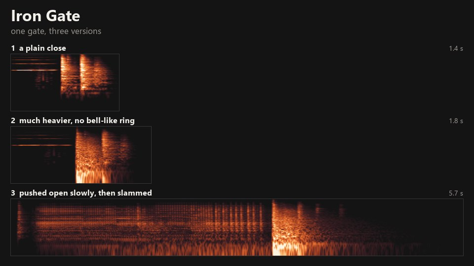
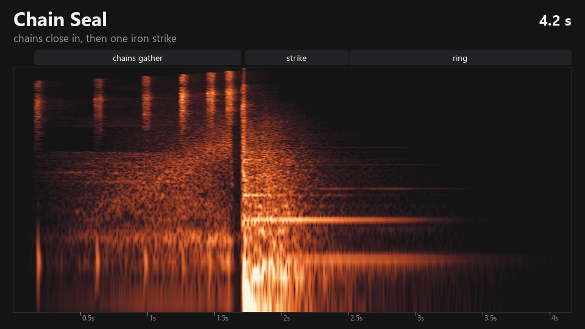
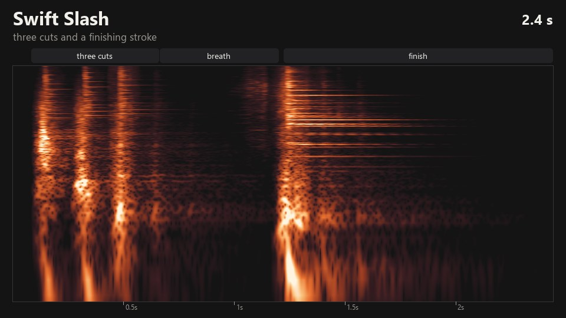
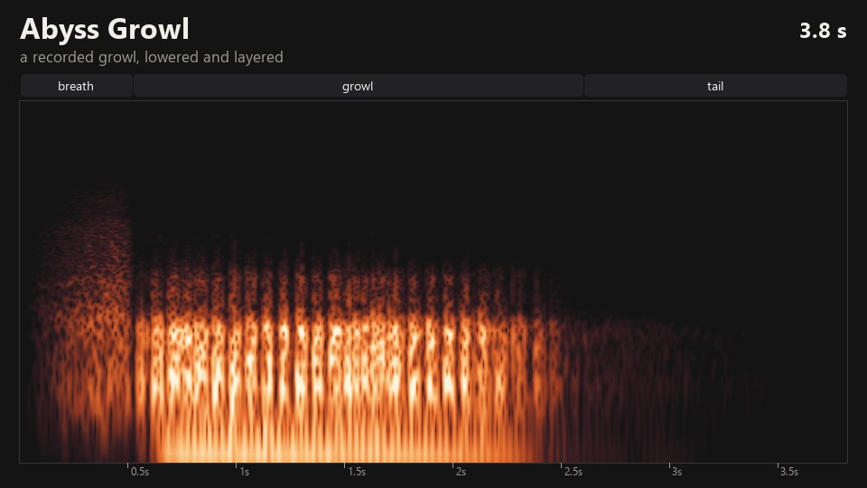
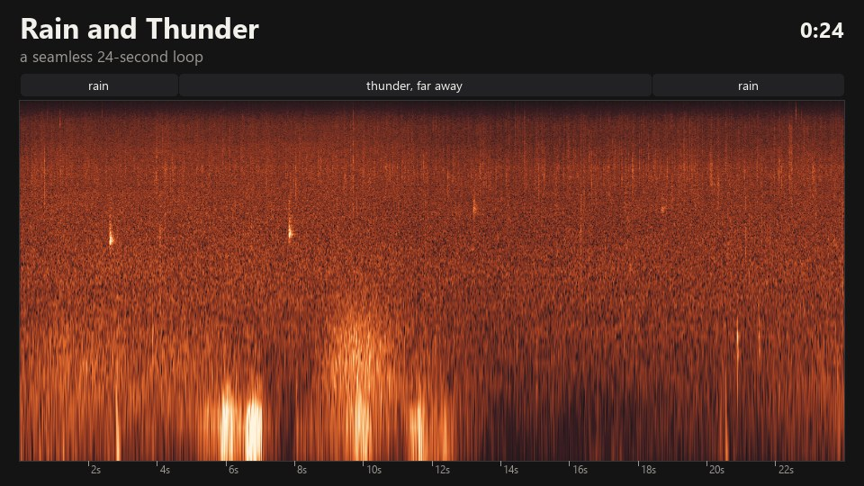
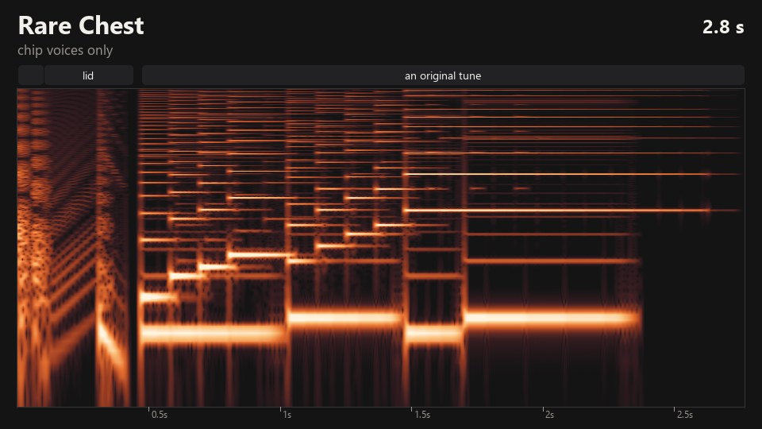

<p align="center">
  <picture>
    <source media="(prefers-color-scheme: dark)" srcset="assets/brand/logo-dark-1200.png">
    
  </picture>
</p>

<p align="center">
  <a href="README.md">English</a> ·
  <a href="README.zh-TW.md">繁體中文</a> ·
  <a href="README.zh-CN.md">简体中文</a> ·
  <strong>日本語</strong> ·
  <a href="README.ko.md">한국어</a>
</p>

<p align="center">
  <a href="https://github.com/owoevan-dev/sfx-skill/actions/workflows/tests.yml"></a>
  <a href="LICENSE"></a>
  
</p>

<p align="center"><strong>生成せず、デザインする。</strong></p>

sfx-skill は、サウンドデザイナーのやり方でゲームの効果音を作るための [Agent Skill](https://agentskills.io) です。エージェントは合成音と実際のフィールド録音を使い、一つひとつの音をレイヤー（アタック、ボディ、低域の重み、テール）で組み立てます。スキルはそれをレンダリングし、セット全体のラウドネスをそろえ、つなぎ目のきれいなループを作り、お使いのゲームエンジン向けに書き出します。

音声生成モデルは一切使いません。どの音もプロジェクトファイル内の読める設定です。レイヤーを一つ変えて、レンダリングし直すだけです。

## 試聴

オリジナルゲームの短いシーンと 6 つの効果音です。どの音も、エージェントがこのスキルで合成音と CC0 のフィールド録音から編集できるレイヤーとして作りました。これらは磨き上げた作例で、最初の出力そのままではありません。人が聴いてバージョンを選び、1 つの音は作り直させました。シーン内の音の配置とミックスは別のスクリプトで行っています。

**音声をオンにしてください。** 『雨の社』0:40：雨の中で鉄の門をくぐると、闇にひそむ怪物。封印と一閃のあと、遺物を手に、また雨の中へ。[MP3](https://github.com/owoevan-dev/sfx-skill/releases/download/examples-1/the-rain-shrine.mp3)

https://github.com/user-attachments/assets/23ff56ba-839f-43e6-ab21-d8557511ab95

<table>
<tr>
<td width="33%" valign="top"><a href="https://github.com/owoevan-dev/sfx-skill/releases/download/examples-1/iron-gate-3.mp3"></a><br><b><a href="https://github.com/owoevan-dev/sfx-skill/releases/download/examples-1/iron-gate-3.mp3">鉄の門</a></b><br>1 つの門の 3 つのバージョン：<a href="https://github.com/owoevan-dev/sfx-skill/releases/download/examples-1/iron-gate-1.mp3">普通に閉まる</a> / <a href="https://github.com/owoevan-dev/sfx-skill/releases/download/examples-1/iron-gate-2.mp3">ずっと重く、鈴のように鳴らない</a> / <a href="https://github.com/owoevan-dev/sfx-skill/releases/download/examples-1/iron-gate-3.mp3">ゆっくり開いて、激しく閉まる</a></td>
<td width="33%" valign="top"><a href="https://github.com/owoevan-dev/sfx-skill/releases/download/examples-1/chain-seal.mp3"></a><br><b><a href="https://github.com/owoevan-dev/sfx-skill/releases/download/examples-1/chain-seal.mp3">鎖の封印</a></b><br>両側から鎖が迫り、鉄の一撃で閉じる。4 秒</td>
<td width="33%" valign="top"><a href="https://github.com/owoevan-dev/sfx-skill/releases/download/examples-1/swift-slash.mp3"></a><br><b><a href="https://github.com/owoevan-dev/sfx-skill/releases/download/examples-1/swift-slash.mp3">疾風斬り</a></b><br>三連撃と締めの一太刀。2 秒</td>
</tr>
<tr>
<td width="33%" valign="top"><a href="https://github.com/owoevan-dev/sfx-skill/releases/download/examples-1/abyss-growl.mp3"></a><br><b><a href="https://github.com/owoevan-dev/sfx-skill/releases/download/examples-1/abyss-growl.mp3">深淵のうなり</a></b><br>録音したうなり声を低くして重ね、より巨大な生き物に。4 秒</td>
<td width="33%" valign="top"><a href="https://github.com/owoevan-dev/sfx-skill/releases/download/examples-1/rain-and-thunder-loop.mp3"></a><br><b><a href="https://github.com/owoevan-dev/sfx-skill/releases/download/examples-1/rain-and-thunder-loop.mp3">雨と遠雷</a></b><br>24 秒のシームレスなループ</td>
<td width="33%" valign="top"><a href="https://github.com/owoevan-dev/sfx-skill/releases/download/examples-1/rare-chest.mp3"></a><br><b><a href="https://github.com/owoevan-dev/sfx-skill/releases/download/examples-1/rare-chest.mp3">レアな宝箱</a></b><br>ピクセルの宝箱とオリジナルの短い旋律。チップ音源のみ。3 秒</td>
</tr>
</table>

これらの音とプロジェクトファイルは CC0 です。リリース [examples-1](https://github.com/owoevan-dev/sfx-skill/releases/tag/examples-1) に、[使用した録音の一覧](https://github.com/owoevan-dev/sfx-skill/releases/download/examples-1/CREDITS.md)とともに置いています。

## クイックスタート

1. スキルをインストールします。Claude Code では:

   ```
   /plugin marketplace add owoevan-dev/sfx-skill
   /plugin install sfx-skill@sfx-skill
   ```

   Codex などのエージェントでは: `npx skills add owoevan-dev/sfx-skill`
2. 普段の言葉で頼みます:

   > 私の Godot の RPG 用に効果音を作って。石畳と草地の足音、剣を振る音と当たる音、重い扉、コイン、メニュー音、村の環境音ループ。

3. エージェントが渡す試聴ページを開きます。各音とそのバリエーションを再生し、残す・直す・やめるを選んでメモを書き、フィードバックをエージェントに貼り付けて返します。

合成音はインストール直後から使えます。実際の録音を使うときは、エージェントが一度確認してからライブラリをダウンロードします。ダウンロードは 2.9 GB で、取り込み後はアーカイブを削除するまで約 7.2 GB のディスクを使います。

**音楽も必要ですか？** [music-skill](https://github.com/owoevan-dev/music-skill) は、編集できる音符でオリジナルの器楽曲やゲーム用ループを作ります。両方を入れると、エージェントが曲のテンポ、セクション、和音を読み取ってテーマのメロディーを効果音に引用でき、試聴ページでは効果音を曲に重ねて聴けます。music-skill のセットアップでは [Surge XT](https://surge-synthesizer.github.io) も入り、そのパッチは自ら動き響く魔法や SF の効果音に向いています。どちらのスキルも単独で使えます。

## 生成すればいいのでは？

| | テキストから音を作るモデル | sfx-skill |
|---|---|---|
| 一部だけ変える | 生成し直す | レイヤーを一つ変えてレンダリング |
| 音のバリエーション | 別々に生成 | 一つのデザインのピッチ、タイミング、テイクを変え、ラウドネスはそろえたまま |
| ループ | つなぎ目を隠す必要がある | 最初からループとして作り、つなぎ目を測定 |
| ゲームに合わせる | おおよそ | 長さもヒット点も正確で、エンジン向けに設定済みのファイル |
| 音の出どころ | モデルの中 | 合成と録音、それぞれライセンスを明記 |
| 同じ音をもう一度 | 別のテイクになる | 同じプロジェクトから同じ音声 |

すでにエージェントがゲームを作っているなら、それぞれの音の役割を知っています。画面で何が起きるか、どれくらい繰り返されるか、同時に何が鳴っているか。それに合わせて音をデザインし、ファイルをプロジェクトに入れてつなぐことができます。

## しくみ

1. **ブリーフとパレット。** エージェントはゲームの世界、素材、スタイル、音が必要なイベント、ループにするものを整理し、セット全体で共有するパレットにします。
2. **デザイン。** 各音をレイヤーとして書きます。オシレーター、FM、チップ音源、ノイズ、打撃のモード、雨、風、録音、そして music-skill があれば Surge XT のパッチを使い、それぞれにエンベロープ、ピッチ、フィルターがあります。UI、レトロ、SF、魔法、打撃、環境音の 43 のレシピは、手を加えるための出発点です。
3. **レンダリング。** 各音をバリエーションごと書き出し、セット全体をトゥルーピークの上限内で同じラウドネスにそろえます。形式は 48 kHz 24-bit WAV です。
4. **測定。** エージェントは音を聴けないので、スキルが代わりに各ファイルを読みます。クリック、途切れた終わり、直流オフセット、一番大きい瞬間が意図どおりか、音の明るさ、密度、長さ、そしてスペクトルの画像です。
5. **試聴。** 一つのファイルでできた試聴ページで聴きます。各バリエーション、重複しないランダム再生、高速連打、ループのつなぎ目、カーソル移動・選択・決定のような一連の音を、ゲームの音楽に重ねても聴けます。ページはあなたの言語で表示されます。あなたのメモはエージェントに戻ります。
6. **書き出し。** Godot、Unity、Unreal、Roblox、Web 向けのファイルと、推奨設定のマニフェストを出力します。Godot と Unity の書き出しは実際にエンジンへ読み込んで確認済みです。Unreal と Roblox の書き出しは各エンジンのドキュメントに従っており、使ってみた結果の[報告](https://github.com/owoevan-dev/sfx-skill/issues)を歓迎します。

## 詳しく

<a id="install"></a>

<details>
<summary><b>インストール</b></summary>

**どこで動くか。** あなたのコンピューター上で、そこでコマンドを実行できるエージェントを通して動きます。Python 3.10 以降と NumPy が必要です。このリポジトリのフォルダでインストールしてください（インストール済みのスキルのフォルダにも `requirements.txt` があり、`doctor` がコマンドを表示します）:

```
python -m pip install -r skills/sound-effects/requirements.txt
```

**Claude Code**

```
/plugin marketplace add owoevan-dev/sfx-skill
/plugin install sfx-skill@sfx-skill
```

**Codex**

```
codex plugin marketplace add owoevan-dev/sfx-skill
codex plugin add sfx-skill@sfx-skill
```

**そのほかのエージェント**

```
npx skills add owoevan-dev/sfx-skill
```

または `skills/sound-effects` をエージェントの skills フォルダーにコピーします。

**任意。** Ogg、MP3、FLAC の書き出しと、WAV 以外の音の取り込みには、PATH 上の [FFmpeg](https://ffmpeg.org) が必要です。サンプリング楽器と Surge XT のレイヤーには [music-production](https://github.com/owoevan-dev/music-skill) スキル（music-skill に含まれます）が必要です。

**何を実行し、取得し、送信するか。** スキルはあなたのコンピューターで自身の Python スクリプトと、お持ちの場合は FFmpeg を実行し、オフラインでレンダリングします。ネットワークを使うのは録音のダウンロードに同意したときだけで、取得先はこのプロジェクトのリリースか Zenodo のデータセットのページです。すべてのファイルは公開されたチェックサムと照合します。どこにも何も送信しません。詳しくは [PRIVACY.md](PRIVACY.md) と [SECURITY.md](SECURITY.md) をご覧ください。

</details>

<details>
<summary><b>使い方</b></summary>

普段の言葉でエージェントに頼みます:

> パズルゲームのメニュー音を作って。カーソル移動、選択、戻る、やわらかいエラー音。温かく、控えめに。

> ホラーゲーム用に、きしみながら開いて、バタンと閉まる重い鉄の扉がほしい。

> 宇宙シューティングのレーザー、プラズマ砲、大爆発を作って、Unity 向けに書き出して。

> 夜のシーン用に、12 秒のステレオのシームレスな雨のループを作って。

> このフォルダーの足音を使って、巨人の足音にして。

> 扉が明るすぎるし、閉まる音が遅い。その二点を直してレンダリングし直して。

> 剣が当たる音を、もっと重い、もっと明るい、もっと短いの三案ちょうだい。

</details>

<details>
<summary><b>録音と、それを録った人たち</b></summary>

合成だけなら他に何もいりません。本物のアタックや質感がほしいときは、録音を重ねられます:

- **FSD50K。** このプロジェクトのリリースには、ポンペウ・ファブラ大学 Music Technology Group が公開した研究データセット [FSD50K](https://doi.org/10.5281/zenodo.4060432) の一部を収めています。作者が [Freesound](https://freesound.org) で CC0 としてパブリックドメインに提供し、このスキルで品質を確認した 6,718 本の録音で、説明を読んで出所、利用条件、内容に疑いが残ったものは除いています。これらで作った音にクレジットは不要です。リリースには各録音のタイトルとページ、および作者名(名前がメールアドレスの場合を除く)の一覧があります。
- **すでにお持ちの音。** フォルダーや zip をエージェントに渡せば（「この足音を使って」）取り込みます。エージェントは同梱のライセンス文をあなたに見せて一度確認し、ライセンスの条件をそれを使ったすべての成果物に引き継ぎます。

この中にあなたの録音や、あなたの作品を含むものがあり、収録を望まない場合は、[issue を開いてください](https://github.com/owoevan-dev/sfx-skill/issues/new?template=remove_recording.yml)。できるだけ早くリリースから外します。Freesound のアカウントは不要です。

これらの録音は、誰かが作って無償で分けてくれたから存在します。このスキルが役に立ったら、こんな形で彼らを支援できます:

- Freesound は Music Technology Group が立ち上げて運営しており、[寄付](https://freesound.org/donations/donate/)を受け付けています。
- 研究で FSD50K を使う場合は[論文を引用してください](THIRD_PARTY_NOTICES.md#recordings)。
- レンダリングごとに、使った録音が一覧になります。ゲームのクレジットで作者にお礼を伝えたいときに、そのまま使えます。

**サウンドデザイナー自身のパックを収録しない理由。** FSD50K は研究チームが公開しているデータセットで、私たちはその中から選んでいるだけです。デザイナー自身が出しているパックは事情が違います。多くの独立したサウンドデザイナーが、すばらしいパックを無料で、しばしば CC0 で公開しています。そして彼らのページこそ、人々が彼らを知り、支援する場所です。ライセンスが再パッケージを認めていても、私たちは皆さんを彼らのもとへ案内したいと考えています。気に入ったものは作者からダウンロードして、エージェントに渡してください。

</details>

<details>
<summary><b>どこまでできるか</b></summary>

変更のたびに、Linux、macOS、Windows の Python 3.10 から 3.14 でテストを実行します。すべてのレシピをレンダリングして測定し、ラウドネスメーターを FFmpeg と照合します。CI はさらに、同じプロジェクトを各システムでレンダリングしてサンプル単位で比較し、試聴ページを Chromium、Firefox、WebKit で開き、Godot 向けの書き出しを Godot 本体に読み込みます。

音が良いかどうかは別の話で、聴いてみなければわかりません。

</details>

<details>
<summary><b>よくある質問</b></summary>

**商用ゲームで使えますか？** はい。合成、Surge XT、スキルが認める楽器バンク、CC0 やパブリックドメインの録音、ご自身の録音で作った音は、クレジット不要でどんな用途にも使えます。メロディーを引用した音にはそのメロディーの権利がそのまま残るため、引用するのはご自身の音楽か使用が認められた音楽だけにしてください。録音の CC0 表示は各作者自身の表明で保証は付かないため、すべてが正しいとはこのプロジェクトも約束できません。別のライセンスの録音を取り込んで重ねた場合は、その音にそのライセンスの条件が適用され、レンダリング結果、試聴ページ、各書き出しに明記されます。

**どのエージェントで使えますか？** Agent Skills を読み込めて Python を実行できるエージェントです。Claude Code（プラグイン）、Codex、`npx skills` 経由のその他のエージェント。

**インターネットや GPU は必要ですか？** インターネットは録音のダウンロードに一度だけ必要です。レンダリングは CPU でオフラインで行います。

**自分の音は使えますか？** はい。WAV、FLAC、Ogg、MP3、AIFF のフォルダーや zip をエージェントに渡してください。

**録音は必須ですか？** いいえ。UI、レトロ、SF など多くの音は合成です。録音が最も役立つのは、説得力のある合成が難しい音、つまり扉、足音、金属、エンジン、水です。

</details>

<details>
<summary><b>できないこと</b></summary>

- エージェントは音を聴けません。チェックは問題の場所を示しますが、結果を聴くのは人間です。スキルはエージェントに、聴いたと主張しないよう指示しています。
- 作るのはオフラインのファイルです。実行時のオーディオエンジンではなく、ゲームの実行時には何も加えません。
- FSD50K はコミュニティが録音したものなので品質にばらつきがあり、商用のフォーリーライブラリではありません。近くで聴き比べれば、最良の有料ライブラリのほうが上です。
- 合成した金属やエンジンなど複雑な物理音は、録音ほどの説得力がありません。
- 音声や音楽は作りません。音楽は [music-skill](https://github.com/owoevan-dev/music-skill) をご覧ください。

</details>

## ドキュメント

| | |
|---|---|
| [SKILL.md](skills/sound-effects/SKILL.md) | エージェントが従うワークフローとすべてのコマンド |
| [sound-design.md](skills/sound-effects/references/sound-design.md) | ブリーフからパレット、デザインされた音まで。録音の使い方も |
| [project-format.md](skills/sound-effects/references/project-format.md) | プロジェクトファイル |
| [categories.md](skills/sound-effects/references/categories.md)、[ui-sounds.md](skills/sound-effects/references/ui-sounds.md) | レシピと、その規則および出典 |
| [checks.md](skills/sound-effects/references/checks.md) | レベル調整と各測定の意味 |
| [export.md](skills/sound-effects/references/export.md) | 各エンジンが受け取るもの |

## コントリビュート

バグ報告や聴いた感想は [issue](https://github.com/owoevan-dev/sfx-skill/issues) へ、質問やアイデアは [Discussions](https://github.com/owoevan-dev/sfx-skill/discussions) へお願いします。外部からの Pull Request は現在受け付けていません。理由と代わりの方法は [CONTRIBUTING.md](CONTRIBUTING.md) にあります。

## ライセンス

このプロジェクトのコードとドキュメントは [MIT](LICENSE) です。第三者の素材はそれぞれの条件に従い、[THIRD_PARTY_NOTICES.md](THIRD_PARTY_NOTICES.md) に記載しています。
