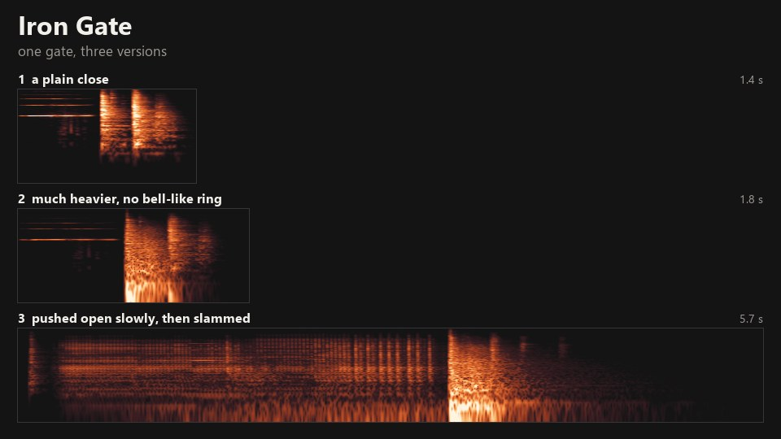
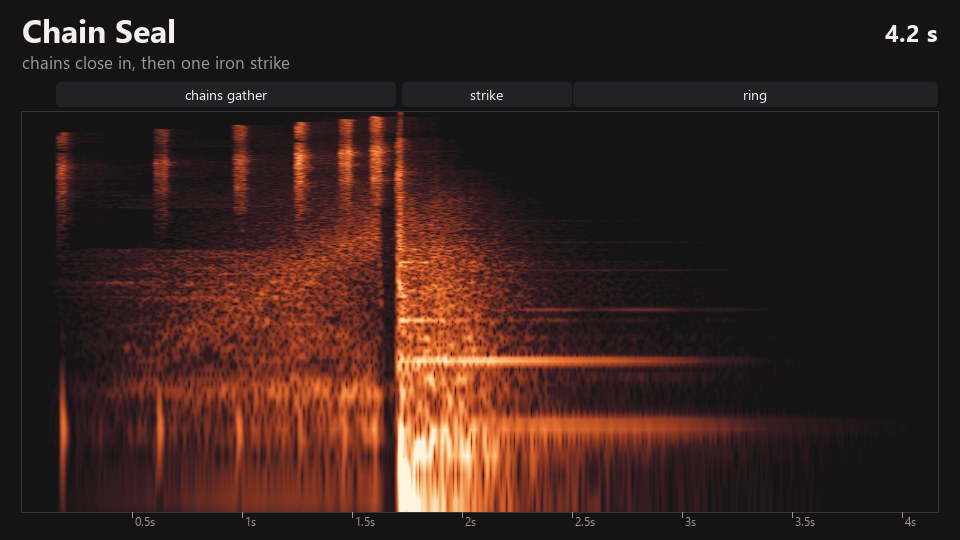
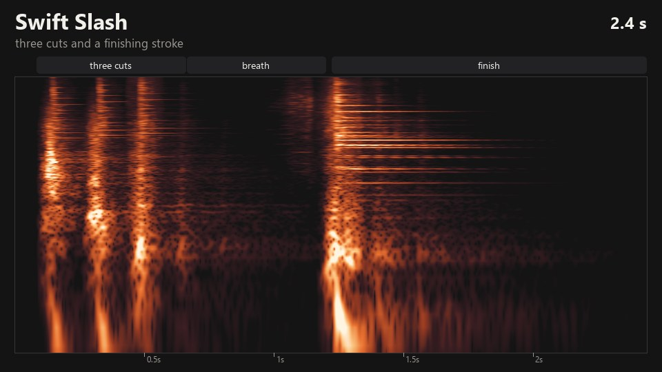
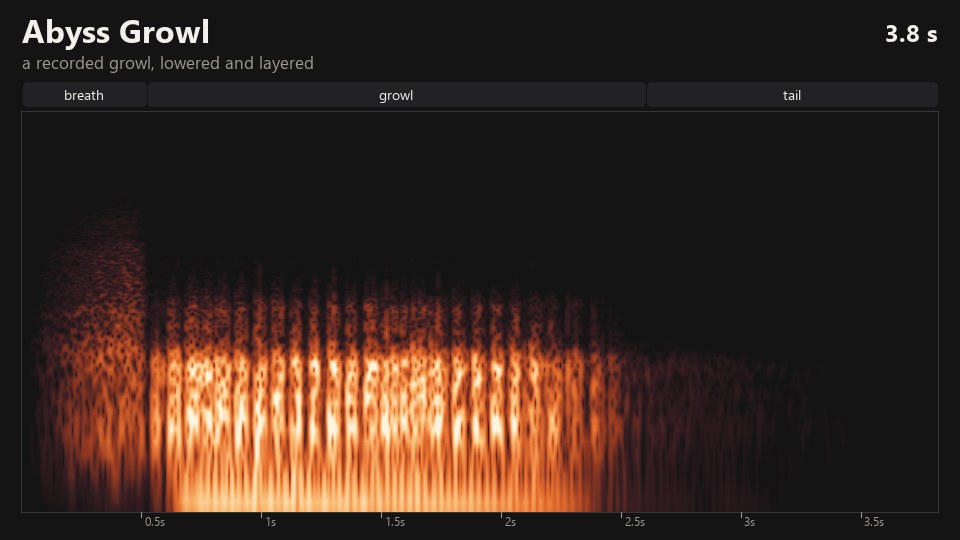
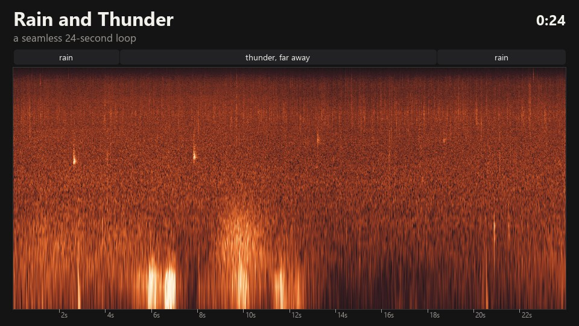
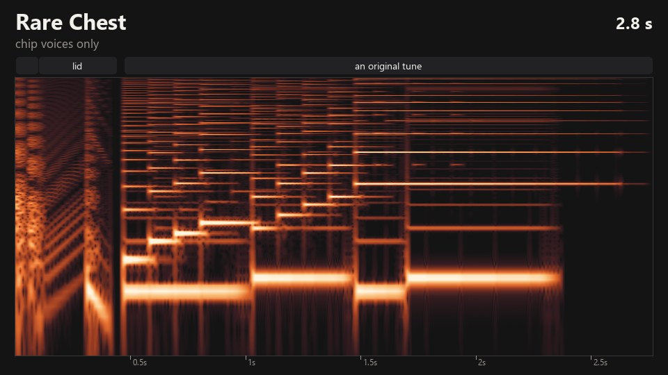

<p align="center">
  <picture>
    <source media="(prefers-color-scheme: dark)" srcset="assets/brand/logo-dark-1200.png">
    
  </picture>
</p>

<p align="center">
  <a href="README.md">English</a> ·
  <a href="README.zh-TW.md">繁體中文</a> ·
  <a href="README.zh-CN.md">简体中文</a> ·
  <a href="README.ja.md">日本語</a> ·
  <strong>한국어</strong>
</p>

<p align="center">
  <a href="https://github.com/owoevan-dev/sfx-skill/actions/workflows/tests.yml"></a>
  <a href="LICENSE"></a>
  
</p>

<p align="center"><strong>생성하지 말고, 디자인하세요.</strong></p>

sfx-skill은 사운드 디자이너가 일하는 방식으로 게임 효과음을 만드는 [Agent Skill](https://agentskills.io)입니다. 에이전트는 합성음과 실제 현장 녹음으로 소리 하나하나를 레이어(어택, 바디, 저음의 무게, 테일)로 쌓아 만듭니다. 스킬은 이를 렌더링하고, 세트 전체의 라우드니스를 맞추고, 이음새가 깨끗한 루프를 만들고, 사용 중인 게임 엔진에 맞게 내보냅니다.

오디오 생성 모델은 전혀 쓰지 않습니다. 모든 소리는 프로젝트 파일 안의 읽을 수 있는 설정입니다. 레이어 하나를 바꾸고 다시 렌더링하면 됩니다.

## 들어보기

오리지널 게임의 짧은 장면과 효과음 여섯 가지입니다. 각 소리는 에이전트가 이 스킬로 합성음과 CC0 현장 녹음을 사용해 편집 가능한 레이어로 만들었습니다. 다듬은 예시이며 첫 결과물 그대로는 아닙니다. 사람이 직접 듣고 버전을 고르고 한 소리는 다시 만들게 했으며, 장면 속 소리의 배치와 믹스는 별도 스크립트로 작업했습니다.

**소리를 켜 주세요.** 《비 내리는 신사》, 0:40: 빗속에서 철문을 지나면 어둠 속의 괴물. 봉인과 일격 끝에 유물을 손에 넣고 다시 빗속으로. [MP3](https://github.com/owoevan-dev/sfx-skill/releases/download/examples-1/the-rain-shrine.mp3)

https://github.com/user-attachments/assets/0f08b86d-b744-4c4c-82b7-ad6162b852ea

<table>
<tr>
<td width="33%" valign="top"><a href="https://github.com/owoevan-dev/sfx-skill/releases/download/examples-1/iron-gate-3.mp3"></a><br><b><a href="https://github.com/owoevan-dev/sfx-skill/releases/download/examples-1/iron-gate-3.mp3">무거운 철문</a></b><br>같은 문의 세 가지 버전: <a href="https://github.com/owoevan-dev/sfx-skill/releases/download/examples-1/iron-gate-1.mp3">평범하게 닫힘</a> / <a href="https://github.com/owoevan-dev/sfx-skill/releases/download/examples-1/iron-gate-2.mp3">훨씬 무겁고 종처럼 울리지 않음</a> / <a href="https://github.com/owoevan-dev/sfx-skill/releases/download/examples-1/iron-gate-3.mp3">천천히 밀어 열고 쾅 닫힘</a></td>
<td width="33%" valign="top"><a href="https://github.com/owoevan-dev/sfx-skill/releases/download/examples-1/chain-seal.mp3"></a><br><b><a href="https://github.com/owoevan-dev/sfx-skill/releases/download/examples-1/chain-seal.mp3">사슬 봉인</a></b><br>양쪽에서 사슬이 조여 오고 마지막에 쇠를 내리치는 일격, 4초</td>
<td width="33%" valign="top"><a href="https://github.com/owoevan-dev/sfx-skill/releases/download/examples-1/swift-slash.mp3"></a><br><b><a href="https://github.com/owoevan-dev/sfx-skill/releases/download/examples-1/swift-slash.mp3">질풍참</a></b><br>세 번의 베기와 마무리 일격, 2초</td>
</tr>
<tr>
<td width="33%" valign="top"><a href="https://github.com/owoevan-dev/sfx-skill/releases/download/examples-1/abyss-growl.mp3"></a><br><b><a href="https://github.com/owoevan-dev/sfx-skill/releases/download/examples-1/abyss-growl.mp3">심연의 으르렁거림</a></b><br>녹음한 으르렁거림을 낮추고 겹쳐 더 거대한 생물로, 4초</td>
<td width="33%" valign="top"><a href="https://github.com/owoevan-dev/sfx-skill/releases/download/examples-1/rain-and-thunder-loop.mp3"></a><br><b><a href="https://github.com/owoevan-dev/sfx-skill/releases/download/examples-1/rain-and-thunder-loop.mp3">비와 먼 천둥</a></b><br>24초 끊김 없는 루프</td>
<td width="33%" valign="top"><a href="https://github.com/owoevan-dev/sfx-skill/releases/download/examples-1/rare-chest.mp3"></a><br><b><a href="https://github.com/owoevan-dev/sfx-skill/releases/download/examples-1/rare-chest.mp3">희귀 보물상자</a></b><br>픽셀 보물상자와 직접 만든 짧은 선율, 칩 음색만 사용, 3초</td>
</tr>
</table>

이 소리와 프로젝트 파일은 CC0입니다. 릴리스 [examples-1](https://github.com/owoevan-dev/sfx-skill/releases/tag/examples-1)에 [사용한 녹음 목록](https://github.com/owoevan-dev/sfx-skill/releases/download/examples-1/CREDITS.md)과 함께 있습니다.

## 빠른 시작

1. 스킬을 설치합니다. Claude Code에서:

   ```
   /plugin marketplace add owoevan-dev/sfx-skill
   /plugin install sfx-skill@sfx-skill
   ```

   Codex와 다른 에이전트에서: `npx skills add owoevan-dev/sfx-skill`
2. 평소 말하듯 요청합니다:

   > 내 Godot RPG에 쓸 효과음을 만들어 줘. 돌길과 풀밭의 발소리, 칼 휘두르기와 타격, 묵직한 문, 동전, 메뉴 소리, 마을 환경음 루프.

3. 에이전트가 주는 시청 페이지를 엽니다. 각 소리와 변형을 재생하고, 유지·수정·제외를 고르고 메모를 남긴 뒤, 피드백을 에이전트에게 붙여 넣습니다.

합성음은 설치 직후 바로 쓸 수 있습니다. 실제 녹음이 필요하면 에이전트가 먼저 물어본 뒤 라이브러리를 한 번 내려받습니다. 다운로드는 3.1 GB이며, 가져온 뒤 압축 파일을 지우기 전까지 디스크를 약 8 GB 사용합니다.

**음악도 필요하신가요?** [music-skill](https://github.com/owoevan-dev/music-skill)은 편집 가능한 음표로 독창적인 기악곡과 게임용 루프를 만듭니다. 두 스킬은 각각 따로 사용할 수 있습니다.

## 그냥 생성하면 안 되나요?

| | 텍스트로 소리를 만드는 모델 | sfx-skill |
|---|---|---|
| 일부만 바꾸기 | 다시 생성 | 레이어 하나를 바꾸고 렌더링 |
| 소리의 변형 | 따로따로 생성 | 하나의 디자인에서 음높이, 타이밍, 테이크를 바꾸고 라우드니스는 동일 |
| 루프 | 이음새를 숨겨야 함 | 처음부터 루프로 만들고 이음새를 측정 |
| 게임에 맞추기 | 대략 | 길이와 타격 지점이 정확하고, 엔진에 맞게 설정된 파일 |
| 소리의 출처 | 모델 내부 | 합성과 녹음, 각각 라이선스 명시 |
| 같은 소리를 다시 | 새로운 테이크 | 같은 프로젝트에서 같은 오디오 |

에이전트가 이미 게임을 만들고 있다면 각 소리가 해야 할 일을 알고 있습니다. 화면에서 무슨 일이 일어나는지, 얼마나 자주 반복되는지, 동시에 무엇이 울리는지. 그에 맞춰 소리를 디자인하고, 파일을 프로젝트에 넣어 연결할 수 있습니다.

## 작동 방식

1. **브리프와 팔레트.** 에이전트가 게임의 세계, 재질, 스타일, 소리가 필요한 이벤트와 루프할 것을 정리해 세트 전체가 공유하는 팔레트로 만듭니다.
2. **디자인.** 각 소리를 레이어로 씁니다. 오실레이터, FM, 칩 음색, 노이즈, 타격 모드, 비, 바람, 녹음을 쓰며, 각각 엔벨로프, 음높이, 필터를 가집니다. UI, 레트로, SF, 마법, 타격, 환경음을 다루는 43개의 레시피는 손봐서 쓰는 출발점입니다.
3. **렌더링.** 각 소리를 변형과 함께 출력하고, 세트 전체를 트루 피크 상한 아래에서 같은 라우드니스로 맞춥니다. 형식은 48 kHz 24-bit WAV입니다.
4. **측정.** 에이전트는 소리를 듣지 못하므로 스킬이 대신 각 파일을 읽습니다. 클릭, 잘린 끝부분, DC 오프셋, 가장 큰 순간이 의도한 지점인지, 소리의 밝기와 밀도와 길이, 그리고 스펙트럼 그림입니다.
5. **시청.** 파일 하나로 된 시청 페이지에서 듣습니다. 각 변형, 반복 없는 무작위 재생, 빠른 연타, 루프 이음새, 커서 이동·선택·확인 같은 연속 동작까지. 여러분의 메모는 에이전트에게 돌아갑니다.
6. **내보내기.** Godot, Unity, Unreal, Roblox, 웹용 파일과 권장 설정이 담긴 매니페스트를 출력합니다.

## 더 알아보기

<a id="install"></a>

<details>
<summary><b>설치</b></summary>

**어디서 실행되나요.** 여러분의 컴퓨터에서, 그곳에서 명령을 실행할 수 있는 에이전트를 통해 실행됩니다. Python 3.10 이상과 NumPy가 필요합니다. 이 저장소 폴더에서 설치하세요(설치된 스킬 폴더에도 `requirements.txt`가 있고, `doctor`가 명령을 알려 줍니다):

```
python -m pip install -r skills/sound-effects/requirements.txt
```

**Claude Code**

```
/plugin marketplace add owoevan-dev/sfx-skill
/plugin install sfx-skill@sfx-skill
```

**Codex**

```
codex plugin marketplace add owoevan-dev/sfx-skill
codex plugin add sfx-skill@sfx-skill
```

**다른 에이전트**

```
npx skills add owoevan-dev/sfx-skill
```

또는 `skills/sound-effects`를 에이전트의 skills 폴더에 복사합니다.

**선택 사항.** Ogg, MP3, FLAC 내보내기와 WAV가 아닌 소리 가져오기에는 PATH에 있는 [FFmpeg](https://ffmpeg.org)가 필요합니다. 샘플 악기 레이어에는 [music-production](https://github.com/owoevan-dev/music-skill) 스킬이 필요합니다.

**무엇을 실행하고, 받고, 보내나요.** 스킬은 여러분의 컴퓨터에서 자체 Python 스크립트와 (있다면) FFmpeg를 실행하고 오프라인으로 렌더링합니다. 네트워크는 녹음 다운로드에 동의했을 때만 쓰며, 이 프로젝트의 릴리스나 Zenodo의 데이터셋 페이지에서 받습니다. 모든 파일은 공개된 체크섬과 대조합니다. 어디로도 아무것도 보내지 않습니다. 자세한 내용은 [PRIVACY.md](PRIVACY.md)와 [SECURITY.md](SECURITY.md)를 보세요.

</details>

<details>
<summary><b>사용법</b></summary>

평소 말하듯 에이전트에게 요청하세요:

> 내 퍼즐 게임의 메뉴 소리를 만들어 줘. 커서 이동, 선택, 뒤로, 부드러운 오류음. 따뜻하고 작게.

> 공포 게임에 쓸, 삐걱대며 열리고 쾅 닫히는 무거운 철문이 필요해.

> 우주 슈팅 게임의 레이저, 플라스마 포, 큰 폭발을 만들고 Unity용으로 내보내 줘.

> 밤 장면에 쓸 12초짜리 스테레오 빗소리 심리스 루프를 만들어 줘.

> 이 폴더의 발소리를 써서 거인의 발소리로 만들어 줘.

> 문이 너무 밝고 닫히는 소리가 늦어. 그 두 가지를 고쳐서 다시 렌더링해 줘.

> 칼 타격음을 더 무겁게, 더 밝게, 더 짧게, 세 가지 버전으로 줘.

</details>

<details>
<summary><b>녹음, 그리고 그것을 녹음한 사람들</b></summary>

합성만 쓴다면 다른 것은 필요 없습니다. 진짜 어택과 질감이 필요할 때는 녹음을 겹칠 수 있습니다:

- **FSD50K.** 이 프로젝트의 릴리스에는 폼페우 파브라 대학교 Music Technology Group이 공개한 연구 데이터셋 [FSD50K](https://doi.org/10.5281/zenodo.4060432)의 일부가 들어 있습니다. 작성자가 [Freesound](https://freesound.org)에서 CC0로 퍼블릭 도메인에 기증했고 이 스킬의 품질 검사를 통과한 녹음 7,405개이며, 작성자 설명에 어떤 요청이든 있는 것은 제외했습니다. 이것으로 만든 소리에는 출처 표시가 필요 없습니다. 릴리스에는 각 녹음의 작성자, 제목, 페이지 목록이 있습니다.
- **이미 가지고 있는 소리.** 폴더나 zip을 에이전트에게 건네면("이 발소리를 써 줘") 가져옵니다. 에이전트는 함께 온 라이선스 내용을 보여 주고 한 번 확인받은 뒤, 라이선스의 조건을 그것으로 만든 모든 결과물에 이어 줍니다.

이 안에 여러분이 녹음한 소리가 있고 포함되기를 원하지 않는다면 [이슈를 열어 주세요](https://github.com/owoevan-dev/sfx-skill/issues/new?template=remove_recording.yml). 다음 릴리스에서 빼겠습니다.

이 녹음들은 누군가 마이크를 들고 어딘가로 가서 그 결과를 아무 대가 없이 나눠 준 덕분에 존재합니다. 이 스킬이 도움이 되었다면 그들을 응원해 주세요:

- Freesound는 Music Technology Group이 시작하고 운영하며 [기부](https://freesound.org/donations/donate/)를 받습니다.
- 연구에 FSD50K를 쓴다면 [논문을 인용해 주세요](THIRD_PARTY_NOTICES.md#recordings).
- 렌더링할 때마다 사용한 녹음의 작성자가 나열됩니다. 필수가 아니더라도 출처 표시에는 비용이 들지 않습니다.

**이 프로젝트가 누구의 사운드 팩도 싣지 않는 이유.** 많은 독립 사운드 디자이너가 훌륭한 팩을 무료로, 종종 CC0로 공개합니다. 그리고 그들의 페이지야말로 사람들이 그들을 알고 응원하는 곳입니다. 라이선스가 재포장을 허용하더라도 우리는 여러분을 그들에게 안내하고 싶습니다. 마음에 드는 것은 제작자에게서 내려받고, 가능하면 고마움을 전한 뒤 에이전트에게 건네주세요.

</details>

<details>
<summary><b>어디까지 되나요</b></summary>

변경할 때마다 Linux, macOS, Windows의 Python 3.10부터 3.14까지에서 테스트를 실행합니다. 모든 레시피를 렌더링해 측정하고, 라우드니스 미터를 FFmpeg와 대조합니다. CI는 또한 같은 프로젝트를 각 시스템에서 렌더링해 샘플 단위로 비교하고, 시청 페이지를 Chromium, Firefox, WebKit에서 열고, Godot 내보내기를 Godot에서 직접 가져옵니다.

소리가 좋은지는 다른 문제이고, 들어 봐야만 알 수 있습니다.

</details>

<details>
<summary><b>자주 묻는 질문</b></summary>

**상업용 게임에 써도 되나요?** 네. 합성, 스킬이 허용하는 악기 뱅크, CC0나 퍼블릭 도메인 녹음, 또는 본인의 녹음으로 만든 소리는 출처 표시 없이 어떤 용도로든 쓸 수 있습니다. 다른 라이선스의 녹음을 가져와 겹치면 그 소리에 해당 라이선스의 조건이 적용되며, 렌더링 결과, 시청 페이지, 각 내보내기에 명시됩니다.

**어떤 에이전트에서 쓸 수 있나요?** Agent Skills를 불러오고 Python을 실행할 수 있는 에이전트입니다. Claude Code(플러그인), Codex, `npx skills`를 통한 다른 에이전트.

**인터넷이나 GPU가 필요한가요?** 인터넷은 녹음을 내려받을 때 한 번만 필요합니다. 렌더링은 CPU로 오프라인에서 합니다.

**제 소리를 쓸 수 있나요?** 네. WAV, FLAC, Ogg, MP3, AIFF 폴더나 zip을 에이전트에게 건네세요.

**녹음이 꼭 필요한가요?** 아니요. UI, 레트로, SF 등 많은 소리는 합성입니다. 녹음이 가장 도움이 되는 것은 설득력 있게 합성하기 어려운 소리, 즉 문, 발소리, 금속, 엔진, 물입니다.

</details>

<details>
<summary><b>한계</b></summary>

- 에이전트는 소리를 듣지 못합니다. 검사는 문제의 위치를 알려 줄 뿐이고 결과는 사람이 들어야 하며, 스킬은 에이전트에게 들었다고 주장하지 말라고 지시합니다.
- 오프라인 파일을 만듭니다. 런타임 오디오 엔진이 아니며 게임 실행 중에는 아무것도 더하지 않습니다.
- FSD50K는 커뮤니티가 녹음해서 품질이 고르지 않고, 상업용 폴리 라이브러리가 아닙니다. 가까이서 비교하면 최고의 유료 라이브러리가 여전히 앞섭니다.
- 합성한 금속, 엔진 같은 복잡한 물리적 소리는 녹음만큼 설득력이 없습니다.
- 음성이나 음악은 만들지 않습니다. 음악은 [music-skill](https://github.com/owoevan-dev/music-skill)을 보세요.
- Unreal과 Roblox 내보내기는 각 엔진의 문서를 따랐지만 엔진에서 직접 열어 확인하지는 않았습니다.

</details>

## 문서

| | |
|---|---|
| [SKILL.md](skills/sound-effects/SKILL.md) | 에이전트가 따르는 작업 흐름과 모든 명령 |
| [sound-design.md](skills/sound-effects/references/sound-design.md) | 브리프에서 팔레트, 디자인된 소리까지. 녹음 사용법 포함 |
| [project-format.md](skills/sound-effects/references/project-format.md) | 프로젝트 파일 |
| [categories.md](skills/sound-effects/references/categories.md), [ui-sounds.md](skills/sound-effects/references/ui-sounds.md) | 레시피와 그 규칙 및 출처 |
| [checks.md](skills/sound-effects/references/checks.md) | 레벨 단계와 각 측정의 의미 |
| [export.md](skills/sound-effects/references/export.md) | 각 엔진이 받는 것 |

## 기여

버그 보고와 청취 의견은 [이슈](https://github.com/owoevan-dev/sfx-skill/issues)로, 질문과 아이디어는 [Discussions](https://github.com/owoevan-dev/sfx-skill/discussions)로 부탁드립니다. 외부 Pull Request는 현재 받지 않습니다. 이유와 대안은 [CONTRIBUTING.md](CONTRIBUTING.md)에 있습니다.

## 라이선스

이 프로젝트의 코드와 문서는 [MIT](LICENSE)입니다. 제3자 자료는 각자의 조건을 따르며 [THIRD_PARTY_NOTICES.md](THIRD_PARTY_NOTICES.md)에 나열되어 있습니다.
