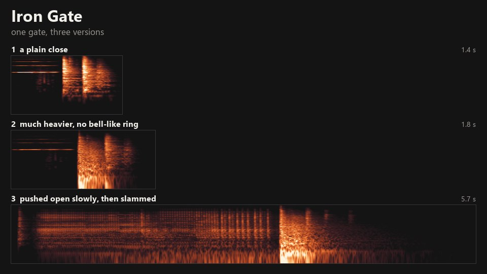
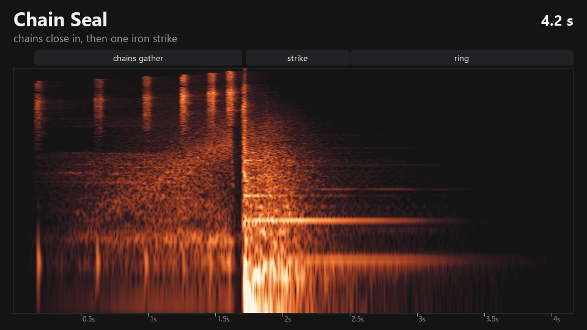
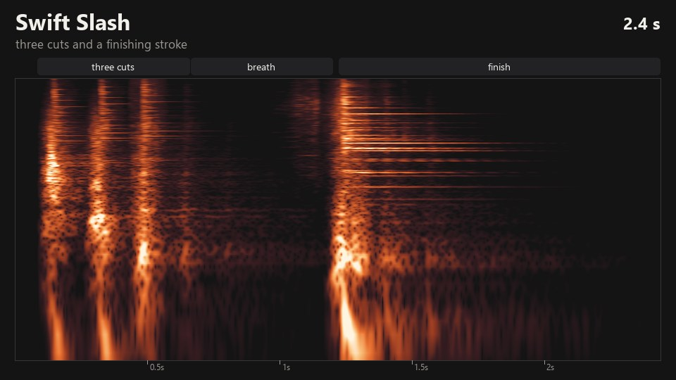
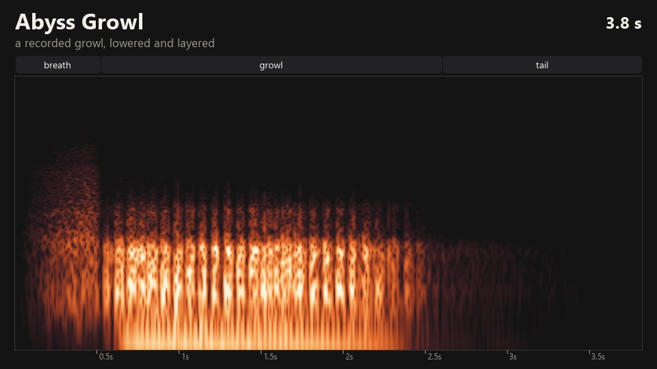
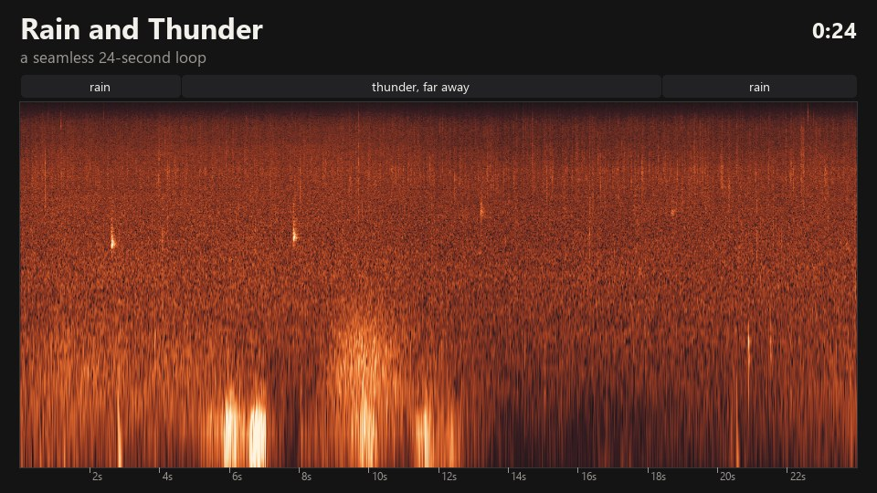
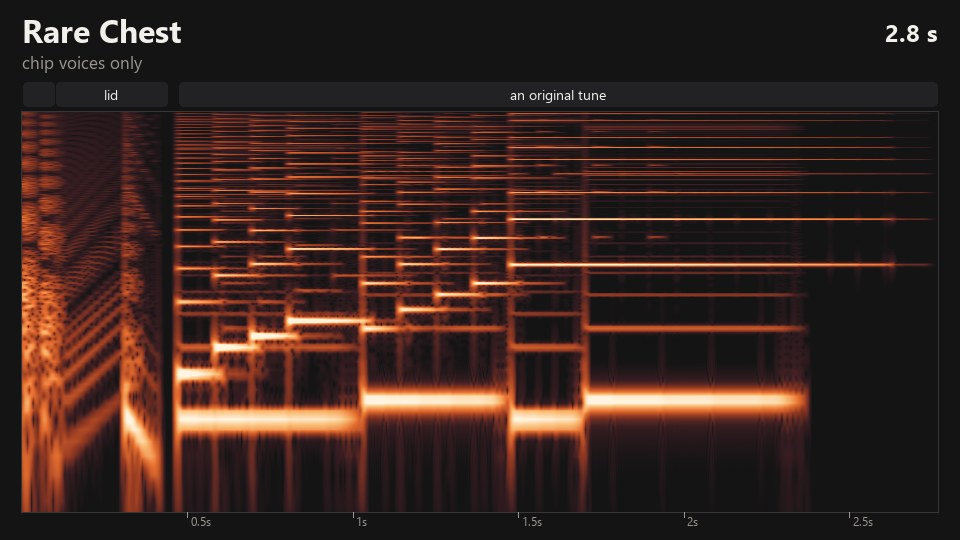

<p align="center">
  <picture>
    <source media="(prefers-color-scheme: dark)" srcset="assets/brand/logo-dark-1200.png">
    
  </picture>
</p>

<p align="center">
  <strong>English</strong> ·
  <a href="README.zh-TW.md">繁體中文</a> ·
  <a href="README.zh-CN.md">简体中文</a> ·
  <a href="README.ja.md">日本語</a> ·
  <a href="README.ko.md">한국어</a>
</p>

<p align="center">
  <a href="https://github.com/owoevan-dev/sfx-skill/actions/workflows/tests.yml"></a>
  <a href="LICENSE"></a>
  
</p>

<p align="center"><strong>Don't generate it. Design it.</strong></p>

sfx-skill is an [Agent Skill](https://agentskills.io) for making a game's sound effects the way a sound designer would. The agent builds each sound from layers (an attack, a body, low weight, a tail) out of synthesis and real field recordings. The skill renders it, brings the whole set to one loudness, makes loops that join cleanly and exports the files for your engine.

No audio-generation model is involved. Every sound is a readable entry in a project file: change one layer and render again.

## Listen

A short scene from an original game and six sounds. An agent built each sound with this skill, as editable layers from synthesis and CC0 field recordings. These are polished examples, not first attempts: a person chose between versions by ear and sent one sound back, and the scene was arranged and mixed with a separate script.

**Turn the sound on.** *The Rain Shrine*, 0:40: through the rain and an iron gate, something in the dark, a seal and a blade, a relic, and back out into the rain. [MP3](https://github.com/owoevan-dev/sfx-skill/releases/download/examples-1/the-rain-shrine.mp3)

https://github.com/user-attachments/assets/23ff56ba-839f-43e6-ab21-d8557511ab95

<table>
<tr>
<td width="33%" valign="top"><a href="https://github.com/owoevan-dev/sfx-skill/releases/download/examples-1/iron-gate-3.mp3"></a><br><b><a href="https://github.com/owoevan-dev/sfx-skill/releases/download/examples-1/iron-gate-3.mp3">Iron Gate</a></b><br>One gate, three versions: <a href="https://github.com/owoevan-dev/sfx-skill/releases/download/examples-1/iron-gate-1.mp3">a plain close</a> / <a href="https://github.com/owoevan-dev/sfx-skill/releases/download/examples-1/iron-gate-2.mp3">much heavier, no bell-like ring</a> / <a href="https://github.com/owoevan-dev/sfx-skill/releases/download/examples-1/iron-gate-3.mp3">pushed open slowly, then slammed</a></td>
<td width="33%" valign="top"><a href="https://github.com/owoevan-dev/sfx-skill/releases/download/examples-1/chain-seal.mp3"></a><br><b><a href="https://github.com/owoevan-dev/sfx-skill/releases/download/examples-1/chain-seal.mp3">Chain Seal</a></b><br>chains close in from both sides, then one iron strike, 4 s</td>
<td width="33%" valign="top"><a href="https://github.com/owoevan-dev/sfx-skill/releases/download/examples-1/swift-slash.mp3"></a><br><b><a href="https://github.com/owoevan-dev/sfx-skill/releases/download/examples-1/swift-slash.mp3">Swift Slash</a></b><br>three cuts and a finishing stroke, 2 s</td>
</tr>
<tr>
<td width="33%" valign="top"><a href="https://github.com/owoevan-dev/sfx-skill/releases/download/examples-1/abyss-growl.mp3"></a><br><b><a href="https://github.com/owoevan-dev/sfx-skill/releases/download/examples-1/abyss-growl.mp3">Abyss Growl</a></b><br>a recorded growl, lowered and layered into something larger, 4 s</td>
<td width="33%" valign="top"><a href="https://github.com/owoevan-dev/sfx-skill/releases/download/examples-1/rain-and-thunder-loop.mp3"></a><br><b><a href="https://github.com/owoevan-dev/sfx-skill/releases/download/examples-1/rain-and-thunder-loop.mp3">Rain and Thunder</a></b><br>a seamless 24-second loop</td>
<td width="33%" valign="top"><a href="https://github.com/owoevan-dev/sfx-skill/releases/download/examples-1/rare-chest.mp3"></a><br><b><a href="https://github.com/owoevan-dev/sfx-skill/releases/download/examples-1/rare-chest.mp3">Rare Chest</a></b><br>a pixel chest and an original tune, chip voices only, 3 s</td>
</tr>
</table>

These sounds and their project files are CC0. They are on the release [examples-1](https://github.com/owoevan-dev/sfx-skill/releases/tag/examples-1), with [credits for every recording they use](https://github.com/owoevan-dev/sfx-skill/releases/download/examples-1/CREDITS.md).

## Quick start

1. Install the skill. In Claude Code:

   ```
   /plugin marketplace add owoevan-dev/sfx-skill
   /plugin install sfx-skill@sfx-skill
   ```

   For Codex and other agents: `npx skills add owoevan-dev/sfx-skill`.
2. Ask for sounds in plain words:

   > Make the sound effects for my Godot RPG: footsteps on stone and grass, a sword swing and hit, a heavy door, coins, menu sounds and a village ambience loop.

3. Open the audition page the agent gives you. Play each sound and its variants, mark it keep, change or drop, leave a note, and paste the feedback back to the agent.

Synthesis works as soon as the skill is installed. For real recordings, the agent asks you once before it downloads the library: 2.9 GB to fetch, and about 7.2 GB on disk until you remove the downloaded archives.

**Need music too?** [music-skill](https://github.com/owoevan-dev/music-skill) writes original instrumental music and game loops as editable notes. With both installed, the agent can read your music's tempo, sections and harmony and quote its theme in a sound, and you hear the sounds over the track on the audition page. music-skill's setup also brings [Surge XT](https://surge-synthesizer.github.io), whose patches suit magic and sci-fi sounds that move and ring by themselves. Each skill works without the other.

## Why not just generate it?

| | A text-to-sound model | sfx-skill |
|---|---|---|
| Changing one part | generate again | change one layer and render |
| Variants of a sound | separate generations | one design with its pitch, timing or take varied, at one loudness |
| Loops | a seam to hide | built as a loop, with its join measured |
| Fitting the game | roughly | exact lengths and hit points, in files set up for your engine |
| Where the sound comes from | inside the model | synthesis and recordings, each with its licence named |
| The same sound again | a new take | the same audio from the same project |

If an agent is already building your game, it knows what each sound has to do: what happens on screen, how often it repeats, what plays over it. It can design for that, put the files in your project and wire them up.

## How it works

1. **Brief and palette.** The agent settles the game's world, materials and style, which events need sounds and which of them loop, and turns that into a palette the whole set shares.
2. **Design.** Each sound is written as layers: oscillators, FM, chip voices, noise, struck modes, rain, wind, recordings and, with music-skill, Surge XT patches, each with its own envelope, pitch and filter. Forty-three recipes for interface, retro, sci-fi, magic, impact and ambience sounds are starting points to adapt.
3. **Render.** Every sound comes out with its variants, the set at one loudness under a true-peak ceiling, as 48 kHz 24-bit WAV.
4. **Measure.** The agent cannot hear, so the skill reads each file for it: clicks, cut endings, offsets, the loudest moment against the intended one, how bright, dense and long the sound is, and a picture of its spectrum.
5. **Listen.** You hear the sounds on a single-file audition page: each variant, random variants without repeats, rapid repeats, loops across their join, and sequences such as hover, select and confirm, also over your game's music. The page speaks your language. Your notes go back to the agent.
6. **Export.** Files and a manifest of suggested settings for Godot, Unity, Unreal, Roblox and the web. The Godot and Unity exports have been imported into those engines; the Unreal and Roblox ones follow their documentation, and [reports](https://github.com/owoevan-dev/sfx-skill/issues) from either are welcome.

## More

<a id="install"></a>

<details>
<summary><b>Install</b></summary>

**Where it runs.** On your own computer, through an agent that runs commands there. It needs Python 3.10 or newer with NumPy. Install it from this repository's folder (an installed skill has `requirements.txt` in its own folder, and `doctor` prints the command):

```
python -m pip install -r skills/sound-effects/requirements.txt
```

**Claude Code**

```
/plugin marketplace add owoevan-dev/sfx-skill
/plugin install sfx-skill@sfx-skill
```

**Codex**

```
codex plugin marketplace add owoevan-dev/sfx-skill
codex plugin add sfx-skill@sfx-skill
```

**Other agents**

```
npx skills add owoevan-dev/sfx-skill
```

Or copy `skills/sound-effects` into your agent's skills folder.

**Optional.** [FFmpeg](https://ffmpeg.org) on the PATH for Ogg, MP3 and FLAC exports and for importing sounds that are not WAV. An installed [music-production](https://github.com/owoevan-dev/music-skill) skill (from music-skill) for layers played on sampled instruments and on Surge XT.

**What it runs, fetches and sends.** The skill runs its Python scripts and, if you have it, FFmpeg, on your computer, and renders offline. It goes online only when you agree to download the recordings, from this project's release or from the dataset's record on Zenodo, and every file is checked against a published checksum. It sends nothing anywhere. See [PRIVACY.md](PRIVACY.md) and [SECURITY.md](SECURITY.md).

</details>

<details>
<summary><b>Using it</b></summary>

Ask your agent in plain words:

> Make menu sounds for my puzzle game: hover, select, back and a soft error. Keep them warm and quiet.

> I need a heavy iron gate that creaks open and slams shut, for a horror game.

> Make a laser, a plasma cannon and a big explosion for my space shooter, then export them for Unity.

> Make a seamless rain loop for a night scene, twelve seconds, in stereo.

> Use the footsteps in this folder and make them sound like a giant.

> The door is too bright and the slam comes too late. Fix those two things and render again.

> Give me three versions of the sword hit: heavier, brighter and shorter.

</details>

<details>
<summary><b>Recordings, and the people who made them</b></summary>

Synthesis needs nothing else. For real attacks and textures the skill can layer recordings:

- **FSD50K.** This project's release carries a selection from [FSD50K](https://doi.org/10.5281/zenodo.4060432), the open research dataset from the Music Technology Group of Universitat Pompeu Fabra: the 6,718 screened recordings whose authors dedicated them to the public domain (CC0) on [Freesound](https://freesound.org), leaving out those whose source, terms of use or content left room for doubt when their descriptions were read. Sounds made with them need no credit. The release lists every recording's title and page, and its author unless the name is an email address.
- **Sounds you already have.** Hand the agent a folder or a zip ("use these footsteps") and it imports them. The agent shows you the licence text that came with them and asks you to confirm it once, and what the licence asks for is carried into everything made with them.

If one of these recordings is yours or holds your work and you would rather it were not included, [open an issue](https://github.com/owoevan-dev/sfx-skill/issues/new?template=remove_recording.yml) and it will come out of the release as soon as we can. You don't need a Freesound account.

Every one of these recordings exists because someone made it and gave it away. If the skill is useful to you, here is how to support them:

- Freesound, started and hosted by the Music Technology Group, takes [donations](https://freesound.org/donations/donate/).
- If you use FSD50K in research, [cite the paper](THIRD_PARTY_NOTICES.md#recordings).
- Each render lists the recordings it used, ready for your game's credits if you want to thank their authors.

**Why the project doesn't bundle sound designers' own packs.** FSD50K is a research dataset that already shares these recordings openly; we only select from it. A designer's own pack is different. Many independent sound designers publish excellent packs for free, often under CC0, and their own pages are how people find them and support them. A licence may allow repackaging their work; we would rather send you to them. Download what you like from its creator and hand it to the agent.

</details>

<details>
<summary><b>How well it works</b></summary>

Every change runs the tests on Linux, macOS and Windows, on Python 3.10 to 3.14. They render every recipe, measure the results and check the loudness meter against FFmpeg's. CI also renders one project on each system and compares the files sample by sample, opens the audition page in Chromium, Firefox and WebKit, and imports a Godot export into Godot itself.

Whether a sound is good is another matter, and only listening can tell.

</details>

<details>
<summary><b>Questions</b></summary>

**Can I use the sounds in a commercial game?** Yes. A sound made from synthesis, Surge XT, the instrument banks the skill allows, CC0 or public-domain recordings or your own needs no credit and may be used for anything. A sound that quotes a melody keeps that melody's rights, so quote your own music or music you may use. A recording's CC0 mark is its author's own statement and comes with no warranty, so the project cannot promise that every one is right. If you layer a recording you imported under another licence, its conditions apply to that sound, and the render, its audition page and each export say which.

**Which agents can use it?** Any agent that loads Agent Skills and can run Python: Claude Code as a plugin, Codex, and others through `npx skills`.

**Does it need the internet or a GPU?** The internet only to download the recordings, once. Rendering runs offline on the CPU.

**Can I use my own sounds?** Yes: hand the agent a folder or a zip of WAV, FLAC, Ogg, MP3 or AIFF files.

**Do I need the recordings?** No. Interface, retro, sci-fi and many other sounds are synthesized. Recordings help most with what is hard to synthesize convincingly: doors, footsteps, metal, engines, water.

</details>

<details>
<summary><b>Limits</b></summary>

- The agent cannot listen. The checks locate faults; a person has to hear the result, and the skill tells the agent never to claim it listened.
- It makes files, offline. It is not a runtime audio engine and adds nothing to your game at run time.
- FSD50K was recorded by a community, so its quality varies, and it is not a commercial foley library. Up close, the best paid libraries are still ahead.
- Synthesized metal, engines and other complex physical sounds are less convincing than recordings of them.
- It does not make speech or music. For music, see [music-skill](https://github.com/owoevan-dev/music-skill).

</details>

## Documentation

| | |
|---|---|
| [SKILL.md](skills/sound-effects/SKILL.md) | The workflow the agent follows, and every command |
| [sound-design.md](skills/sound-effects/references/sound-design.md) | From a brief to a palette and to designed sounds, with recordings |
| [project-format.md](skills/sound-effects/references/project-format.md) | The project file |
| [categories.md](skills/sound-effects/references/categories.md), [ui-sounds.md](skills/sound-effects/references/ui-sounds.md) | The recipes, with the rules they follow and their sources |
| [checks.md](skills/sound-effects/references/checks.md) | The level step and what the measurements mean |
| [export.md](skills/sound-effects/references/export.md) | What each engine receives |

## Contributing

Bug reports and listening notes are welcome as [issues](https://github.com/owoevan-dev/sfx-skill/issues). Questions and ideas go to [Discussions](https://github.com/owoevan-dev/sfx-skill/discussions). Pull requests from outside the project are closed for now; [CONTRIBUTING.md](CONTRIBUTING.md) explains why, and what to do instead.

## Licence

[MIT](LICENSE) for this project's code and documentation. Third-party material keeps its own terms, listed in [THIRD_PARTY_NOTICES.md](THIRD_PARTY_NOTICES.md).
