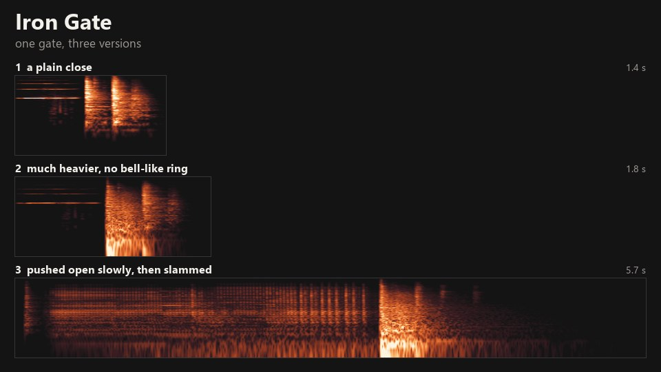
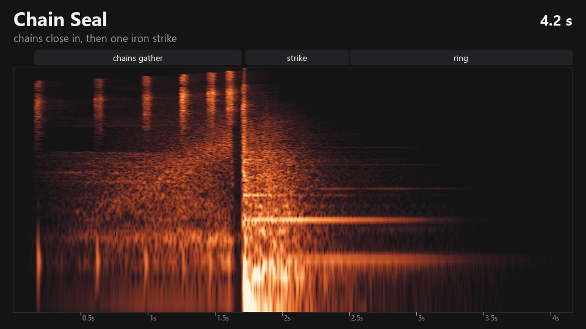
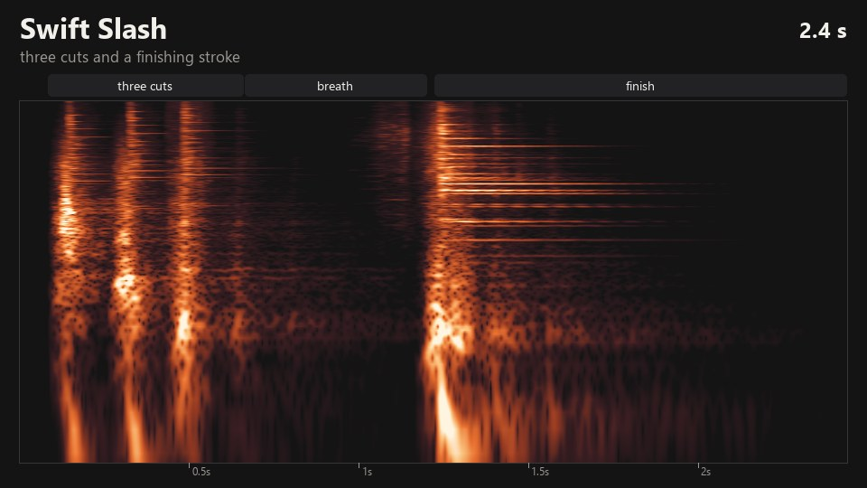
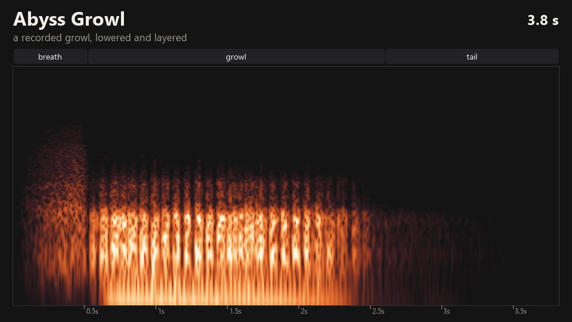
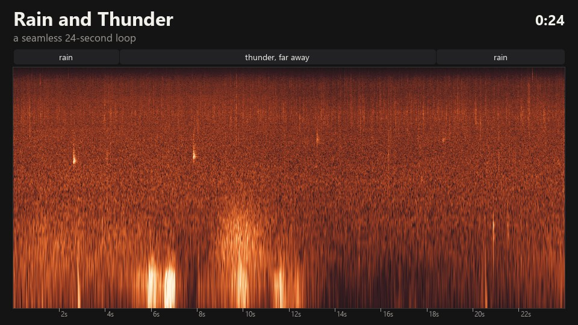
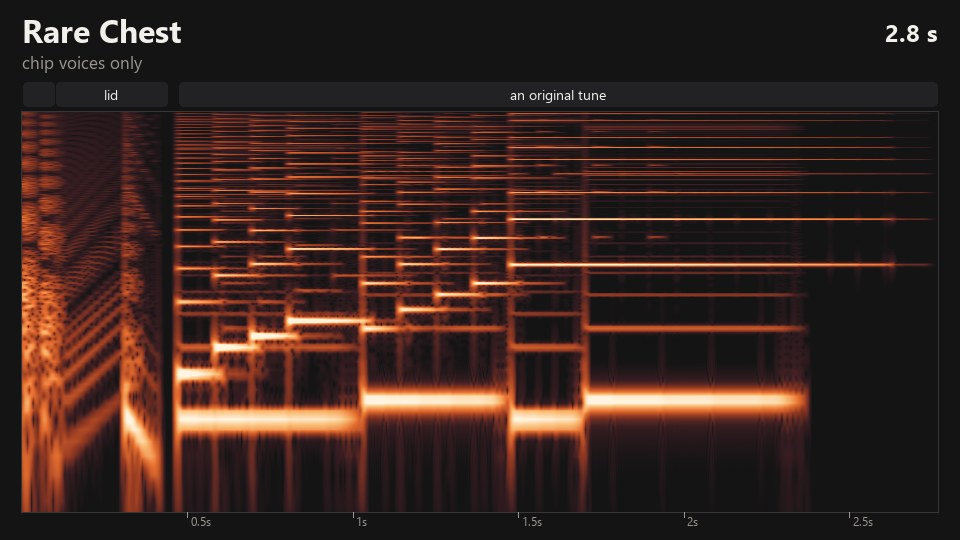

<p align="center">
  <picture>
    <source media="(prefers-color-scheme: dark)" srcset="assets/brand/logo-dark-1200.png">
    
  </picture>
</p>

<p align="center">
  <a href="README.md">English</a> ·
  <a href="README.zh-TW.md">繁體中文</a> ·
  <strong>简体中文</strong> ·
  <a href="README.ja.md">日本語</a> ·
  <a href="README.ko.md">한국어</a>
</p>

<p align="center">
  <a href="https://github.com/owoevan-dev/sfx-skill/actions/workflows/tests.yml"></a>
  <a href="LICENSE"></a>
  
</p>

<p align="center"><strong>不是生成，是设计。</strong></p>

sfx-skill 是一个 [Agent Skill](https://agentskills.io)，让 AI agent 像音效设计师那样为游戏制作音效。agent 用合成音色和真实的现场录音，把每个音效叠成几层（起音、主体、低频重量、尾音）；skill 负责渲染、把整组音效调到一致的响度、做出接缝干净的循环，再导出成你的游戏引擎能用的文件。

整个过程没有用到任何音频生成模型。每个音效都是项目文件里看得懂的一条设置：改其中一层，重新渲染就好。

## 试听

一段原创游戏场景和六组音效。每个音效都由 agent 用这个 skill，以合成音色和 CC0 实地录音做成可编辑的层。这些是打磨过的示例，不是第一次的结果：由真人试听挑选版本并退回一个音效，场景的编排和混音则用另外的脚本完成。

**记得打开声音。** 《雨夜神社》，0:40：冒雨穿过铁门，黑暗里的怪物、封印和刀光，找到遗物，再走回雨中。[MP3](https://github.com/owoevan-dev/sfx-skill/releases/download/examples-1/the-rain-shrine.mp3)

https://github.com/user-attachments/assets/23ff56ba-839f-43e6-ab21-d8557511ab95

<table>
<tr>
<td width="33%" valign="top"><a href="https://github.com/owoevan-dev/sfx-skill/releases/download/examples-1/iron-gate-3.mp3"></a><br><b><a href="https://github.com/owoevan-dev/sfx-skill/releases/download/examples-1/iron-gate-3.mp3">重铁门</a></b><br>同一扇门的三个版本：<a href="https://github.com/owoevan-dev/sfx-skill/releases/download/examples-1/iron-gate-1.mp3">单纯关上</a> / <a href="https://github.com/owoevan-dev/sfx-skill/releases/download/examples-1/iron-gate-2.mp3">重很多、不像铃铛</a> / <a href="https://github.com/owoevan-dev/sfx-skill/releases/download/examples-1/iron-gate-3.mp3">慢慢推开再重重撞上</a></td>
<td width="33%" valign="top"><a href="https://github.com/owoevan-dev/sfx-skill/releases/download/examples-1/chain-seal.mp3"></a><br><b><a href="https://github.com/owoevan-dev/sfx-skill/releases/download/examples-1/chain-seal.mp3">锁链封印</a></b><br>锁链从两侧收紧，最后一记铁击，4 秒</td>
<td width="33%" valign="top"><a href="https://github.com/owoevan-dev/sfx-skill/releases/download/examples-1/swift-slash.mp3"></a><br><b><a href="https://github.com/owoevan-dev/sfx-skill/releases/download/examples-1/swift-slash.mp3">疾风斩</a></b><br>三连斩加收刀，2 秒</td>
</tr>
<tr>
<td width="33%" valign="top"><a href="https://github.com/owoevan-dev/sfx-skill/releases/download/examples-1/abyss-growl.mp3"></a><br><b><a href="https://github.com/owoevan-dev/sfx-skill/releases/download/examples-1/abyss-growl.mp3">深渊低吼</a></b><br>把录制的低吼降调叠层成更巨大的生物，4 秒</td>
<td width="33%" valign="top"><a href="https://github.com/owoevan-dev/sfx-skill/releases/download/examples-1/rain-and-thunder-loop.mp3"></a><br><b><a href="https://github.com/owoevan-dev/sfx-skill/releases/download/examples-1/rain-and-thunder-loop.mp3">雨夜远雷</a></b><br>24 秒无缝循环</td>
<td width="33%" valign="top"><a href="https://github.com/owoevan-dev/sfx-skill/releases/download/examples-1/rare-chest.mp3"></a><br><b><a href="https://github.com/owoevan-dev/sfx-skill/releases/download/examples-1/rare-chest.mp3">稀有宝箱</a></b><br>像素宝箱加一段原创旋律，纯合成，3 秒</td>
</tr>
</table>

这些音效和项目文件都以 CC0 发布，放在 Release [examples-1](https://github.com/owoevan-dev/sfx-skill/releases/tag/examples-1)，并附上[每段录音的出处](https://github.com/owoevan-dev/sfx-skill/releases/download/examples-1/CREDITS.md)。

## 快速开始

1. 安装 skill。在 Claude Code 中：

   ```
   /plugin marketplace add owoevan-dev/sfx-skill
   /plugin install sfx-skill@sfx-skill
   ```

   Codex 和其他 agent：`npx skills add owoevan-dev/sfx-skill`。
2. 用平常说话的方式提出需求：

   > 给我的 Godot RPG 做音效：石板和草地的脚步声、挥剑和击中、厚重的门、金币、菜单音效，还有村庄环境音循环。

3. 打开 agent 给你的试听页。播放每个音效和它的变体，标记保留、修改或不要，留下意见，再把反馈贴回给 agent。

装好 skill 就能用合成音色。需要真实录音时，agent 会先问过你，才下载一次音效库：下载 2.9 GB，导入后连同压缩包约占 7.2 GB，压缩包之后可以自行删除。

**也需要配乐？** [music-skill](https://github.com/owoevan-dev/music-skill) 能写出可编辑的原创器乐和游戏循环音乐。两个都装好后，agent 能读出配乐的速度、段落和和弦，把主题旋律引用进音效，你也能在试听页上把音效叠在配乐上听。music-skill 的安装也会带来 [Surge XT](https://surge-synthesizer.github.io)，它的音色很适合会自己流动、鸣响的魔法和科幻音效。两个 skill 都能单独使用。

## 为什么不直接生成？

| | 文字生成音效的模型 | sfx-skill |
|---|---|---|
| 修改其中一部分 | 重新生成 | 改一层，重新渲染 |
| 同一音效的变体 | 各自生成 | 同一份设计，变化音高、时间或录音片段，响度一致 |
| 循环 | 要想办法藏接缝 | 一开始就做成循环，接缝有测量 |
| 贴合游戏 | 大致上 | 长度和击中点精确，文件已为你的引擎设置好 |
| 声音来源 | 在模型里 | 合成和录音，每一段都标明许可 |
| 再做一次同样的声音 | 又是新的一版 | 同一份项目，得到同样的音频 |

如果 agent 已经在帮你做游戏，它就知道每个声音要做什么：画面上发生什么、多常重复、同时还有什么在响。它能按这些条件设计，把文件放进项目并接上去。

## 工作原理

1. **需求与调色板。** agent 先弄清游戏的世界、材质和风格，哪些事件需要声音、哪些要循环，整理成整组音效共用的调色板。
2. **设计。** 每个音效都写成多层：振荡器、FM、芯片音色、噪声、敲击模态、雨、风、录音，装了 music-skill 还有 Surge XT 音色，各有自己的包络、音高和滤波。43 个涵盖界面、复古、科幻、魔法、打击和环境音的配方，是可以改造的起点。
3. **渲染。** 每个音效连同变体一起输出，整组在真实峰值上限内调到同一响度，格式为 48 kHz 24-bit WAV。
4. **测量。** agent 听不到声音，所以 skill 替它读每个文件：爆音、被截断的结尾、直流偏移、最响的时间点是否符合设计、声音有多亮、多密、多长，还有一张频谱图。
5. **试听。** 你在单一文件的试听页上听：每个变体、不重复的随机变体、快速连发、循环接缝，以及光标移动、选择、确认这类连续动作，也能叠在游戏配乐上听。试听页会用你的语言显示。你的意见会回到 agent 手上。
6. **导出。** 为 Godot、Unity、Unreal、Roblox 和网页输出文件，附上建议设置的清单。Godot 和 Unity 的导出已实际导入引擎确认；Unreal 和 Roblox 的则依照官方文档制作，欢迎[反馈](https://github.com/owoevan-dev/sfx-skill/issues)使用结果。

## 更多内容

<a id="install"></a>

<details>
<summary><b>安装</b></summary>

**在哪里运行。** 在你自己的电脑上，通过能在那里执行命令的 agent。需要 Python 3.10 以上和 NumPy。请在这个仓库的文件夹里安装（已安装的 skill 文件夹内也有 `requirements.txt`，`doctor` 会打印命令）：

```
python -m pip install -r skills/sound-effects/requirements.txt
```

**Claude Code**

```
/plugin marketplace add owoevan-dev/sfx-skill
/plugin install sfx-skill@sfx-skill
```

**Codex**

```
codex plugin marketplace add owoevan-dev/sfx-skill
codex plugin add sfx-skill@sfx-skill
```

**其他 agent**

```
npx skills add owoevan-dev/sfx-skill
```

或把 `skills/sound-effects` 复制到你的 agent 的 skills 文件夹。

**可选。** PATH 上有 [FFmpeg](https://ffmpeg.org)，才能导出 Ogg、MP3、FLAC，以及导入非 WAV 的音效。装了 [music-production](https://github.com/owoevan-dev/music-skill) skill（来自 music-skill），才能用采样乐器和 Surge XT 做音层。

**它会运行、下载和发送什么。** skill 在你的电脑上运行自己的 Python 脚本，以及你已安装的 FFmpeg，全程离线渲染。只有在你同意下载录音时才会联网，来源是本项目的 Release 或数据集在 Zenodo 的页面，每个文件都会比对公开的校验码。它不会把任何东西发送出去。详见 [PRIVACY.md](PRIVACY.md) 和 [SECURITY.md](SECURITY.md)。

</details>

<details>
<summary><b>使用方法</b></summary>

用平常说话的方式告诉 agent：

> 给我的解谜游戏做菜单音效：光标移动、选择、返回和轻柔的错误提示，要温暖、小声一点。

> 我需要一扇沉重的铁门，先嘎吱打开再砰地关上，用在恐怖游戏里。

> 给我的太空射击游戏做激光、等离子炮和大爆炸，然后导出给 Unity。

> 做一段夜景用的无缝雨声循环，十二秒，立体声。

> 用这个文件夹里的脚步声，把它们变成巨人的脚步。

> 这扇门太亮，关门声又来得太晚。修这两点再渲染一次。

> 挥剑击中的声音给我三个版本：更重、更亮、更短。

</details>

<details>
<summary><b>录音，以及录下它们的人</b></summary>

只用合成不需要其他东西。想要真实的起音和质感时，skill 可以叠上录音：

- **FSD50K。** 本项目的 Release 收录了 [FSD50K](https://doi.org/10.5281/zenodo.4060432) 的一部分。这是西班牙庞培法布拉大学音乐技术研究组公开的研究数据集。收录的 6,718 段录音，都是作者在 [Freesound](https://freesound.org) 上以 CC0 贡献到公有领域、并经过本 skill 质量筛选的录音；读过说明后，来源、使用条件或内容仍有疑虑的一律不收。用它们做出来的音效不需要标注来源。Release 里列出每段录音的标题和页面，以及作者名称（名称是 email 的除外）。
- **你已经有的音效。** 把文件夹或 zip 交给 agent（“用这些脚步声”），它就会导入。agent 会把随附的许可内容拿给你确认一次，并把许可的要求带进所有用到它们的成品。

如果这里面有你的录音，或用到了你的作品，而你不希望被收录，请[开一个 issue](https://github.com/owoevan-dev/sfx-skill/issues/new?template=remove_recording.yml)，我们会尽快从发布版中去掉。不需要 Freesound 账号。

这些录音之所以存在，是因为有人把它们做出来并无偿分享。如果这个 skill 对你有帮助，可以这样支持他们：

- Freesound 由音乐技术研究组创立并维护，接受[捐款](https://freesound.org/donations/donate/)。
- 如果你在研究中使用 FSD50K，请[引用论文](THIRD_PARTY_NOTICES.md#recordings)。
- 每次渲染都会列出用到的录音，想在游戏的制作名单里感谢作者时可以直接用。

**为什么不收录创作者自己发布的素材包。** FSD50K 是研究团队公开发布的数据集，我们只从中挑选。创作者自己发布的素材包不一样：许多独立音效设计师免费公开了很棒的素材包，其中不少是 CC0，而他们自己的页面正是大家认识和支持他们的地方。许可也许允许重新打包，但我们宁可把你带到他们那里。喜欢什么就向创作者下载，再交给 agent 使用。

</details>

<details>
<summary><b>效果如何</b></summary>

每次改动都会在 Linux、macOS 和 Windows、Python 3.10 到 3.14 上跑测试：渲染每个配方、测量结果，并拿响度计和 FFmpeg 对照。CI 还会在各系统渲染同一个项目并逐采样比对，在 Chromium、Firefox 和 WebKit 打开试听页，并把 Godot 导出实际导入 Godot。

至于声音好不好，那是另一回事，只有听了才知道。

</details>

<details>
<summary><b>常见问题</b></summary>

**音效可以用在商业游戏吗？** 可以。用合成、Surge XT、skill 允许的乐器音色库、CC0 或公有领域录音，或你自己的录音做出来的音效，都不需要标注来源，也能用于任何用途。引用旋律的音效仍保有那段旋律原本的权利，所以请只引用你自己的音乐或你有权使用的音乐。录音的 CC0 标示是各作者自己的声明，不附任何保证，本项目也无法承诺每一段都正确。如果叠上你导入的其他许可录音，该音效就要遵守那份许可的条件，渲染结果、试听页和每次导出都会写明。

**哪些 agent 能用？** 任何能加载 Agent Skills 并运行 Python 的 agent：Claude Code（插件）、Codex，以及通过 `npx skills` 安装的其他 agent。

**需要网络或 GPU 吗？** 只有下载录音时需要网络，而且只要一次。渲染全程在 CPU 上离线完成。

**可以用我自己的音效吗？** 可以，把 WAV、FLAC、Ogg、MP3 或 AIFF 的文件夹或 zip 交给 agent 就好。

**一定要下载录音吗？** 不用。界面、复古、科幻等很多音效都是合成的。录音最能帮上忙的，是难以合成得逼真的声音：门、脚步、金属、引擎、水。

</details>

<details>
<summary><b>局限</b></summary>

- agent 听不到声音。检查能找出问题，但成品还是要由人来听，skill 也要求 agent 绝不能声称自己听过。
- 它做的是离线文件，不是游戏运行时的音频引擎，也不会在运行时加进你的游戏。
- FSD50K 由社区录制，质量参差，也不是商业拟音音效库。近距离细听，顶尖的付费音效库仍然更好。
- 合成的金属、引擎等复杂物理声音，不如真实录音有说服力。
- 它不做语音和音乐。音乐请看 [music-skill](https://github.com/owoevan-dev/music-skill)。

</details>

## 文档

| | |
|---|---|
| [SKILL.md](skills/sound-effects/SKILL.md) | agent 遵循的工作流程和所有命令 |
| [sound-design.md](skills/sound-effects/references/sound-design.md) | 从需求到调色板、到设计好的音效，以及如何使用录音 |
| [project-format.md](skills/sound-effects/references/project-format.md) | 项目文件格式 |
| [categories.md](skills/sound-effects/references/categories.md)、[ui-sounds.md](skills/sound-effects/references/ui-sounds.md) | 配方、它们遵循的规则和来源 |
| [checks.md](skills/sound-effects/references/checks.md) | 响度步骤和各项测量的意义 |
| [export.md](skills/sound-effects/references/export.md) | 每个引擎会拿到什么 |

## 参与贡献

欢迎用 [issue](https://github.com/owoevan-dev/sfx-skill/issues) 报告问题和听感意见，问题和想法请到 [Discussions](https://github.com/owoevan-dev/sfx-skill/discussions)。目前不接受外部的 Pull Request，原因和替代做法请见 [CONTRIBUTING.md](CONTRIBUTING.md)。

## 许可

本项目的代码和文档采用 [MIT](LICENSE) 许可。第三方素材保留各自的条款，列于 [THIRD_PARTY_NOTICES.md](THIRD_PARTY_NOTICES.md)。
