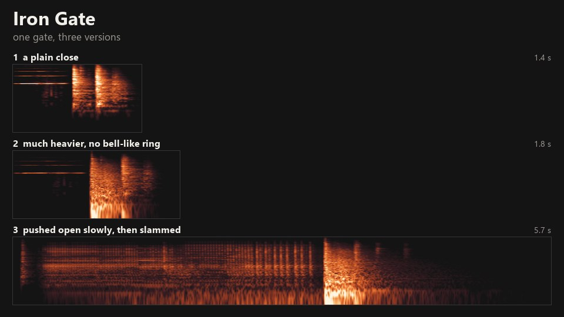
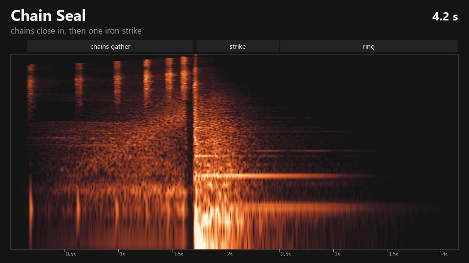
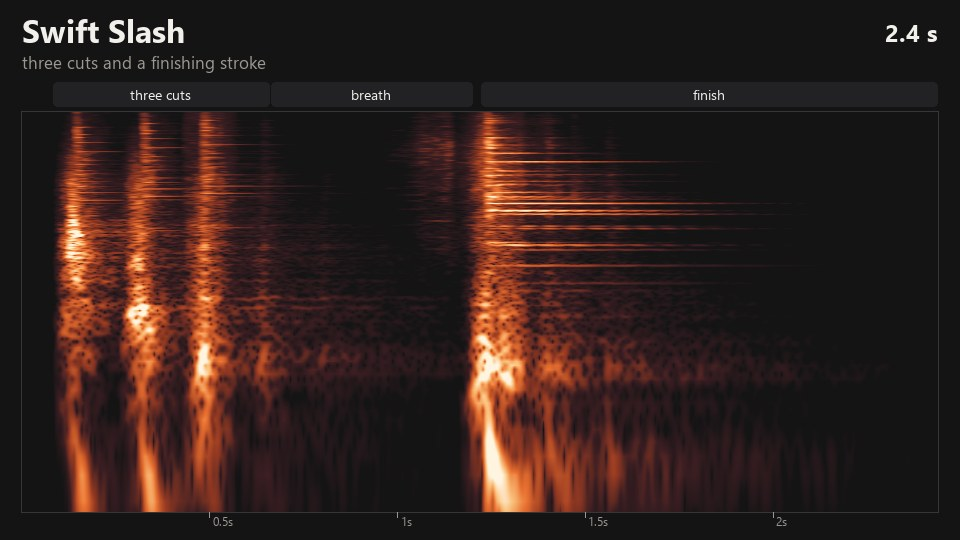
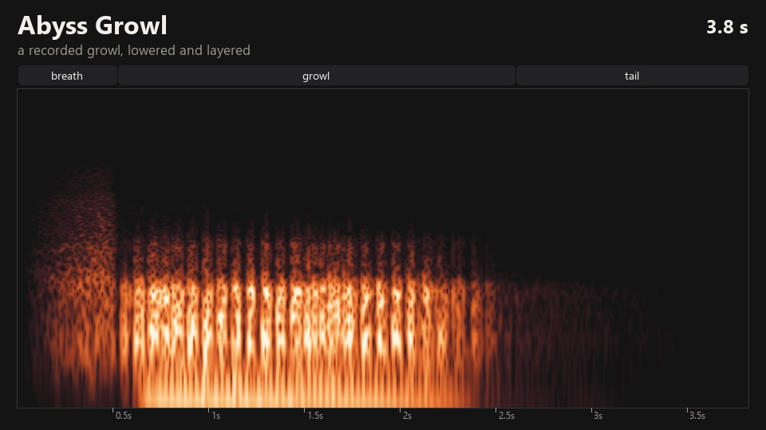
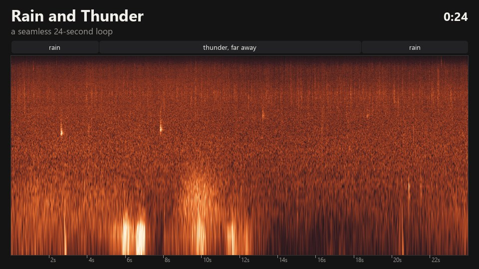
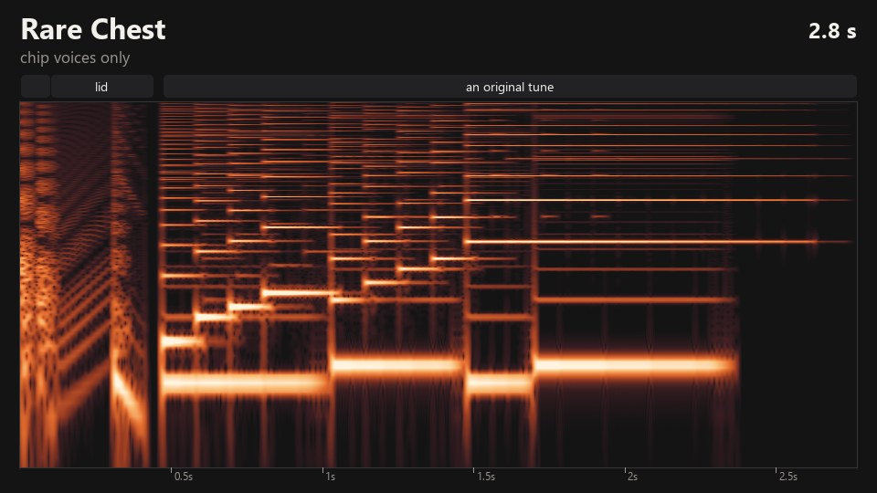

<p align="center">
  <picture>
    <source media="(prefers-color-scheme: dark)" srcset="assets/brand/logo-dark-1200.png">
    
  </picture>
</p>

<p align="center">
  <a href="README.md">English</a> ·
  <strong>繁體中文</strong> ·
  <a href="README.zh-CN.md">简体中文</a> ·
  <a href="README.ja.md">日本語</a> ·
  <a href="README.ko.md">한국어</a>
</p>

<p align="center">
  <a href="https://github.com/owoevan-dev/sfx-skill/actions/workflows/tests.yml"></a>
  <a href="LICENSE"></a>
  
</p>

<p align="center"><strong>不是生成，是設計。</strong></p>

sfx-skill 是一個 [Agent Skill](https://agentskills.io)，讓 AI agent 像音效設計師那樣替遊戲做音效。agent 用合成音色和真實的現場錄音，把每個音效疊成幾層（起音、主體、低頻重量、尾音）；skill 負責渲染、把整組音效調到一致的響度、做出接縫乾淨的循環，再匯出成你的遊戲引擎能用的檔案。

整個過程沒有用到任何音訊生成模型。每個音效都是專案檔裡看得懂的一筆設定：改其中一層，重新渲染就好。

## 試聽

一段原創遊戲場景和六組音效。每個音效都由 agent 用這個 skill，以合成音色和 CC0 實地錄音做成可編輯的層。這些是打磨過的範例，不是第一次的結果：由真人試聽挑選版本並退回一個音效，場景的排列和混音則用另外的腳本完成。

**記得開聲音。** 《雨夜神社》，0:40：冒雨穿過鐵門，黑暗裡的怪物、封印和刀光，找到遺物，再走回雨中。[MP3](https://github.com/owoevan-dev/sfx-skill/releases/download/examples-1/the-rain-shrine.mp3)

https://github.com/user-attachments/assets/23ff56ba-839f-43e6-ab21-d8557511ab95

<table>
<tr>
<td width="33%" valign="top"><a href="https://github.com/owoevan-dev/sfx-skill/releases/download/examples-1/iron-gate-3.mp3"></a><br><b><a href="https://github.com/owoevan-dev/sfx-skill/releases/download/examples-1/iron-gate-3.mp3">重鐵門</a></b><br>同一扇門的三個版本：<a href="https://github.com/owoevan-dev/sfx-skill/releases/download/examples-1/iron-gate-1.mp3">單純關上</a> / <a href="https://github.com/owoevan-dev/sfx-skill/releases/download/examples-1/iron-gate-2.mp3">重很多、不像鈴鐺</a> / <a href="https://github.com/owoevan-dev/sfx-skill/releases/download/examples-1/iron-gate-3.mp3">慢慢推開再重重撞上</a></td>
<td width="33%" valign="top"><a href="https://github.com/owoevan-dev/sfx-skill/releases/download/examples-1/chain-seal.mp3"></a><br><b><a href="https://github.com/owoevan-dev/sfx-skill/releases/download/examples-1/chain-seal.mp3">鎖鏈封印</a></b><br>鎖鏈從兩側收緊，最後一記鐵擊，4 秒</td>
<td width="33%" valign="top"><a href="https://github.com/owoevan-dev/sfx-skill/releases/download/examples-1/swift-slash.mp3"></a><br><b><a href="https://github.com/owoevan-dev/sfx-skill/releases/download/examples-1/swift-slash.mp3">疾風斬</a></b><br>三連斬加收刀，2 秒</td>
</tr>
<tr>
<td width="33%" valign="top"><a href="https://github.com/owoevan-dev/sfx-skill/releases/download/examples-1/abyss-growl.mp3"></a><br><b><a href="https://github.com/owoevan-dev/sfx-skill/releases/download/examples-1/abyss-growl.mp3">深淵低吼</a></b><br>把錄製的低吼降調疊層成更巨大的生物，4 秒</td>
<td width="33%" valign="top"><a href="https://github.com/owoevan-dev/sfx-skill/releases/download/examples-1/rain-and-thunder-loop.mp3"></a><br><b><a href="https://github.com/owoevan-dev/sfx-skill/releases/download/examples-1/rain-and-thunder-loop.mp3">雨夜遠雷</a></b><br>24 秒無縫循環</td>
<td width="33%" valign="top"><a href="https://github.com/owoevan-dev/sfx-skill/releases/download/examples-1/rare-chest.mp3"></a><br><b><a href="https://github.com/owoevan-dev/sfx-skill/releases/download/examples-1/rare-chest.mp3">稀有寶箱</a></b><br>像素寶箱加一段原創旋律，純合成，3 秒</td>
</tr>
</table>

這些音效和專案檔都以 CC0 釋出，放在 Release [examples-1](https://github.com/owoevan-dev/sfx-skill/releases/tag/examples-1)，並附上[每段錄音的出處](https://github.com/owoevan-dev/sfx-skill/releases/download/examples-1/CREDITS.md)。

## 快速開始

1. 安裝 skill。在 Claude Code 中：

   ```
   /plugin marketplace add owoevan-dev/sfx-skill
   /plugin install sfx-skill@sfx-skill
   ```

   Codex 和其他 agent：`npx skills add owoevan-dev/sfx-skill`。
2. 用平常說話的方式提出需求：

   > 幫我的 Godot RPG 做音效：石板和草地的腳步聲、揮劍和擊中、厚重的門、金幣、選單音效，還有村莊環境音循環。

3. 打開 agent 給你的試聽頁。播放每個音效和它的變體，標記保留、修改或不要，留下意見，再把回饋貼回給 agent。

裝好 skill 就能用合成音色。需要真實錄音時，agent 會先問過你，才下載一次音效庫：下載 2.9 GB，匯入後連同壓縮檔約占 7.2 GB，壓縮檔之後可以自行移除。

**也需要配樂？** [music-skill](https://github.com/owoevan-dev/music-skill) 能寫出可編輯的原創器樂和遊戲循環音樂。兩個都裝好後，agent 能讀出配樂的速度、段落和和弦，把主題旋律引用進音效，你也能在試聽頁上把音效疊在配樂上聽。music-skill 的安裝也會帶來 [Surge XT](https://surge-synthesizer.github.io)，它的音色很適合會自己流動、鳴響的魔法和科幻音效。兩個 skill 都能單獨使用。

## 為什麼不直接生成？

| | 文字生成音效的模型 | sfx-skill |
|---|---|---|
| 修改其中一部分 | 重新生成 | 改一層，重新渲染 |
| 同一音效的變體 | 各自生成 | 同一份設計，變化音高、時間或錄音片段，響度一致 |
| 循環 | 要想辦法藏接縫 | 一開始就做成循環，接縫有量測 |
| 貼合遊戲 | 大致上 | 長度和擊中點精確，檔案已為你的引擎設定好 |
| 聲音來源 | 在模型裡 | 合成和錄音，每一段都標明授權 |
| 再做一次同樣的聲音 | 又是新的一版 | 同一份專案，得到同樣的音訊 |

如果 agent 已經在幫你做遊戲，它就知道每個聲音要做什麼：畫面上發生什麼、多常重複、同時還有什麼在響。它能照這些條件設計，把檔案放進專案並接上去。

## 運作方式

1. **需求與調色盤。** agent 先釐清遊戲的世界、材質和風格，哪些事件需要聲音、哪些要循環，整理成整組音效共用的調色盤。
2. **設計。** 每個音效都寫成多層：振盪器、FM、晶片音色、噪音、敲擊模態、雨、風、錄音，裝了 music-skill 還有 Surge XT 音色，各有自己的包絡、音高和濾波。43 個涵蓋介面、復古、科幻、魔法、打擊和環境音的配方，是可以改造的起點。
3. **渲染。** 每個音效連同變體一起輸出，整組在真實峰值上限內調到同一響度，格式為 48 kHz 24-bit WAV。
4. **量測。** agent 聽不到聲音，所以 skill 替它讀每個檔案：爆音、被截斷的結尾、直流偏移、最響的時間點是否符合設計、聲音有多亮、多密、多長，還有一張頻譜圖。
5. **試聽。** 你在單一檔案的試聽頁上聽：每個變體、不重複的隨機變體、快速連發、循環接縫，以及游標移動、選擇、確認這類連續動作，也能疊在遊戲配樂上聽。試聽頁會用你的語言顯示。你的意見會回到 agent 手上。
6. **匯出。** 替 Godot、Unity、Unreal、Roblox 和網頁輸出檔案，附上建議設定的清單。Godot 和 Unity 的匯出已實際匯入引擎確認；Unreal 和 Roblox 的則依照官方文件製作，歡迎[回報](https://github.com/owoevan-dev/sfx-skill/issues)使用結果。

## 更多內容

<a id="install"></a>

<details>
<summary><b>安裝</b></summary>

**在哪裡執行。** 在你自己的電腦上，透過能在那裡執行指令的 agent。需要 Python 3.10 以上和 NumPy。請在這個 repo 的資料夾裡安裝（已安裝的 skill 資料夾內也有 `requirements.txt`，`doctor` 會印出指令）：

```
python -m pip install -r skills/sound-effects/requirements.txt
```

**Claude Code**

```
/plugin marketplace add owoevan-dev/sfx-skill
/plugin install sfx-skill@sfx-skill
```

**Codex**

```
codex plugin marketplace add owoevan-dev/sfx-skill
codex plugin add sfx-skill@sfx-skill
```

**其他 agent**

```
npx skills add owoevan-dev/sfx-skill
```

或把 `skills/sound-effects` 複製到你的 agent 的 skills 資料夾。

**選用。** PATH 上有 [FFmpeg](https://ffmpeg.org)，才能匯出 Ogg、MP3、FLAC，以及匯入非 WAV 的音效。裝了 [music-production](https://github.com/owoevan-dev/music-skill) skill（來自 music-skill），才能用取樣樂器和 Surge XT 做音層。

**它會執行、下載和傳送什麼。** skill 在你的電腦上執行自己的 Python 腳本，以及你已安裝的 FFmpeg，全程離線渲染。只有在你同意下載錄音時才會連網，來源是本專案的 Release 或資料集在 Zenodo 的頁面，每個檔案都會比對公開的校驗碼。它不會把任何東西傳出去。詳見 [PRIVACY.md](PRIVACY.md) 和 [SECURITY.md](SECURITY.md)。

</details>

<details>
<summary><b>使用方式</b></summary>

用平常說話的方式告訴 agent：

> 幫我的解謎遊戲做選單音效：游標移動、選擇、返回和輕柔的錯誤提示，要溫暖、小聲一點。

> 我需要一扇沉重的鐵門，先嘎吱打開再砰地關上，用在恐怖遊戲裡。

> 幫我的太空射擊遊戲做雷射、電漿砲和大爆炸，然後匯出給 Unity。

> 做一段夜景用的無縫雨聲循環，十二秒，立體聲。

> 用這個資料夾裡的腳步聲，把它們變成巨人的腳步。

> 這扇門太亮，關門聲又來得太晚。修這兩點再渲染一次。

> 揮劍擊中的聲音給我三個版本：更重、更亮、更短。

</details>

<details>
<summary><b>錄音，以及錄下它們的人</b></summary>

只用合成不需要其他東西。想要真實的起音和質感時，skill 可以疊上錄音：

- **FSD50K。** 本專案的 Release 收錄了 [FSD50K](https://doi.org/10.5281/zenodo.4060432) 的一部分。這是西班牙龐培法布拉大學音樂科技研究組公開的研究資料集。收錄的 6,718 段錄音，都是作者在 [Freesound](https://freesound.org) 上以 CC0 貢獻到公有領域、並經過本 skill 品質篩選的錄音；讀過說明後，來源、使用條件或內容仍有疑慮的一律不收。用它們做出來的音效不需要標示來源。Release 裡列出每段錄音的標題和頁面，以及作者名稱（名稱是 email 的除外）。
- **你已經有的音效。** 把資料夾或 zip 交給 agent（「用這些腳步聲」），它就會匯入。agent 會把隨附的授權內容拿給你確認一次，並把授權的要求帶進所有用到它們的成品。

如果這裡面有你的錄音，或用到了你的作品，而你不希望被收錄，請[開一個 issue](https://github.com/owoevan-dev/sfx-skill/issues/new?template=remove_recording.yml)，我們會盡快從發行版拿掉。不需要 Freesound 帳號。

這些錄音之所以存在，是因為有人把它們做出來並無償分享。如果這個 skill 對你有幫助，可以這樣支持他們：

- Freesound 由音樂科技研究組創立並維運，接受[捐款](https://freesound.org/donations/donate/)。
- 如果你在研究中使用 FSD50K，請[引用論文](THIRD_PARTY_NOTICES.md#recordings)。
- 每次渲染都會列出用到的錄音，想在遊戲的製作名單裡感謝作者時可以直接用。

**為什麼不收錄創作者自己發行的素材包。** FSD50K 是研究團隊公開發佈的資料集，我們只從中挑選。創作者自己發行的素材包不一樣：許多獨立音效設計師免費公開了很棒的素材包，其中不少是 CC0，而他們自己的頁面正是大家認識和支持他們的地方。授權也許允許重新打包，但我們寧可把你帶到他們那裡。喜歡什麼就向創作者下載，再交給 agent 使用。

</details>

<details>
<summary><b>效果如何</b></summary>

每次改動都會在 Linux、macOS 和 Windows、Python 3.10 到 3.14 上跑測試：渲染每個配方、量測結果，並拿響度計和 FFmpeg 對照。CI 還會在各系統渲染同一個專案並逐取樣比對，在 Chromium、Firefox 和 WebKit 打開試聽頁，並把 Godot 匯出實際匯入 Godot。

至於聲音好不好，那是另一回事，只有聽了才知道。

</details>

<details>
<summary><b>常見問題</b></summary>

**音效可以用在商業遊戲嗎？** 可以。用合成、Surge XT、skill 允許的樂器音色庫、CC0 或公有領域錄音，或你自己的錄音做出來的音效，都不需要標示來源，也能用於任何用途。引用旋律的音效仍保有那段旋律原本的權利，所以請只引用你自己的音樂或你有權使用的音樂。錄音的 CC0 標示是各作者自己的聲明，不附任何保證，本專案也無法承諾每一段都正確。如果疊上你匯入的其他授權錄音，該音效就要遵守那份授權的條件，渲染結果、試聽頁和每次匯出都會寫明。

**哪些 agent 能用？** 任何能載入 Agent Skills 並執行 Python 的 agent：Claude Code（外掛）、Codex，以及透過 `npx skills` 安裝的其他 agent。

**需要網路或 GPU 嗎？** 只有下載錄音時需要網路，而且只要一次。渲染全程在 CPU 上離線完成。

**可以用我自己的音效嗎？** 可以，把 WAV、FLAC、Ogg、MP3 或 AIFF 的資料夾或 zip 交給 agent 就好。

**一定要下載錄音嗎？** 不用。介面、復古、科幻等很多音效都是合成的。錄音最能幫上忙的，是難以合成得逼真的聲音：門、腳步、金屬、引擎、水。

</details>

<details>
<summary><b>限制</b></summary>

- agent 聽不到聲音。檢查能找出問題，但成品還是要由人來聽，skill 也要求 agent 絕不能宣稱自己聽過。
- 它做的是離線檔案，不是遊戲執行時的音訊引擎，也不會在執行時加進你的遊戲。
- FSD50K 由社群錄製，品質參差，也不是商業擬音音效庫。近距離細聽，頂尖的付費音效庫仍然更好。
- 合成的金屬、引擎等複雜物理聲音，不如真實錄音有說服力。
- 它不做語音和音樂。音樂請看 [music-skill](https://github.com/owoevan-dev/music-skill)。

</details>

## 文件

| | |
|---|---|
| [SKILL.md](skills/sound-effects/SKILL.md) | agent 遵循的工作流程和所有指令 |
| [sound-design.md](skills/sound-effects/references/sound-design.md) | 從需求到調色盤、到設計好的音效，以及如何使用錄音 |
| [project-format.md](skills/sound-effects/references/project-format.md) | 專案檔格式 |
| [categories.md](skills/sound-effects/references/categories.md)、[ui-sounds.md](skills/sound-effects/references/ui-sounds.md) | 配方、它們遵循的規則和來源 |
| [checks.md](skills/sound-effects/references/checks.md) | 響度步驟和各項量測的意義 |
| [export.md](skills/sound-effects/references/export.md) | 每個引擎會拿到什麼 |

## 參與貢獻

歡迎用 [issue](https://github.com/owoevan-dev/sfx-skill/issues) 回報問題和聽感意見，問題和想法請到 [Discussions](https://github.com/owoevan-dev/sfx-skill/discussions)。目前不接受外部的 Pull Request，原因和替代做法請見 [CONTRIBUTING.md](CONTRIBUTING.md)。

## 授權

本專案的程式碼和文件採 [MIT](LICENSE) 授權。第三方素材保留各自的條款，列於 [THIRD_PARTY_NOTICES.md](THIRD_PARTY_NOTICES.md)。
